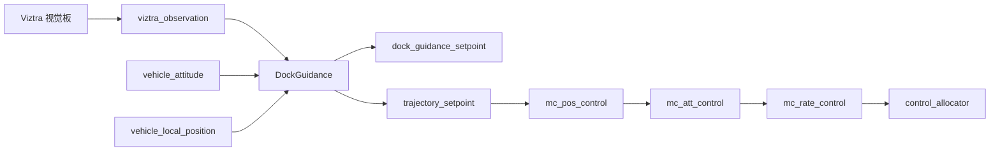
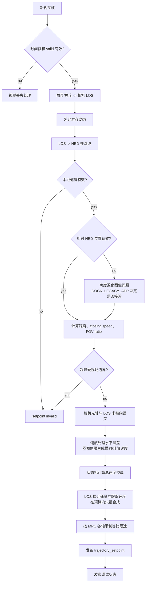
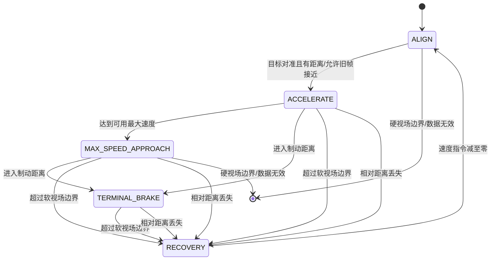
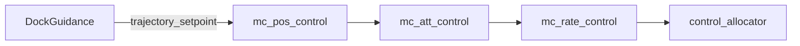

# Dock Guidance 代码逻辑流程图

本页反映当前 `src/modules/dock_guidance` 的三维速度与固定相机图像伺服实现。

## 总体数据流



DockGuidance 不再直接把接近速度误差加到油门。它生成 NED 三维速度设定值，推力、高度和姿态耦合由 PX4 标准多旋翼位置控制器处理。

## 单帧处理



## 状态机



| 阶段 | 主要行为 |
|---|---|
| `ALIGN` | 偏航对准目标，图像伺服低速平移消除偏差 |
| `ACCELERATE` | 增加总速度预算；LOS 接近和图像跟踪共同使用该预算 |
| `MAX_SPEED_APPROACH` | 最终三维速度模长保持 `DOCK_VEL_MAX`，图像修正不叠加额外速度 |
| `TERMINAL_BRAKE` | 按剩余距离和 `DOCK_DEC_MAX` 生成制动速度包络 |
| `RECOVERY` | 视场软边界或短时断流时将速度指令减到零 |

## 最大速度与制动

```text
pointing_error = camera_forward - LOS * dot(LOS, camera_forward)
v_track = -distance * DOCK_IMG_P * pointing_error
|v_track| <= DOCK_IMG_VMAX
v_close_cmd = sqrt(speed_budget^2 - |v_track|^2)
v_sp = v_close_cmd * LOS + v_track

v_brake = sqrt(2 * DOCK_DEC_MAX * max(distance - DOCK_STOP_DIST, 0))
speed_budget = min(DOCK_VEL_MAX, v_brake)
```

机体偏航直接修正能够由 yaw 消除的水平指向误差；平移图像伺服只处理剩余误差，通常表现为固定镜头在加速倾斜时所需的升降修正。这样不会让平移控制与偏航控制互相对抗。

`v_track` 始终投影到 LOS 的垂直平面。高速阶段会从同一个总速度预算中为它预留空间，因此目标偏离时接近分量会暂时减小，但最终速度模长不会因图像修正而超过 `DOCK_VEL_MAX`。目标回到中心后，全部速度预算重新用于接近。

旧 21 字节帧没有距离时，`v_track` 改由画面剩余角误差生成。`ALIGN` 中限制到 `DOCK_ALIGN_SPD`；`DOCK_LEGACY_APP=1` 时可进入高速阶段，跟踪修正限制到 `DOCK_IMG_VMAX`，但不具备距离制动。

在发布前，按 `MPC_XY_VEL_MAX`、`MPC_Z_VEL_MAX_UP` 和 `MPC_Z_VEL_MAX_DN` 对整个速度向量等比缩放，不允许下游单独截断各轴后改变进近方向。

## 视觉丢失

- 短时丢失：进入 `RECOVERY`，按 `DOCK_DEC_MAX` 降低三维速度指令。
- 超过 `max(DOCK_OBS_TOUT, DOCK_VIS_GRACE)`：设定值 invalid，持续发布零速度等待 Commander 退出模式。
- 相对 NED 位置无效：`DOCK_LEGACY_APP=1` 时允许角度跟踪高速接近，否则只能低速对准。
- 本地速度无效：不允许进入/继续 Dock 模式。

## 控制权



Dock 模式需要本地位置、高度、姿态和角速度估计。
