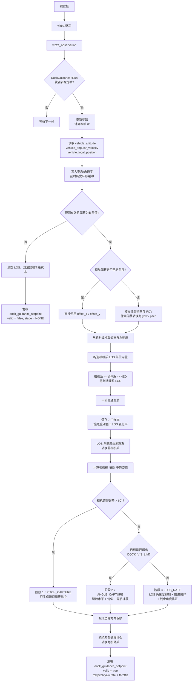
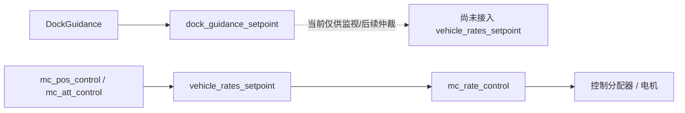

# Dock Guidance 代码逻辑流程图

本文反映当前 `src/modules/dock_guidance` 的实际逻辑。模块由 `viztra_observation` 的新视觉帧触发，输出独立的 `dock_guidance_setpoint`；当前版本**不直接发布** `vehicle_rates_setpoint`，也尚未接管飞行器控制权。

## 三阶段控制目的

| 阶段 | 进入条件 | 控制目标 |
|---|---|---|
| `PITCH_CAPTURE` | 相机俯仰误差大于 60° | 优先改变俯仰，将目标从相机上下边界拉回。 |
| `ANGLE_CAPTURE` | 目标仍在 `DOCK_VIS_LIM` 可视中心范围外 | 使用滚转水平、俯仰与偏航，将目标移动到画面中心区域。 |
| `LOS_RATE` | 目标位于可视中心范围内 | 通过 LOS 变化率降低视线漂移，并叠加前进俯仰和残余角度修正，形成跟踪/对接引导。 |

## 当前输出边界

后续增加 Dock 飞行模式时，应仅在 Dock 模式且视觉目标有效时，将 `dock_guidance_setpoint` 经仲裁接入 `vehicle_rates_setpoint`；退出模式或视觉失效时，恢复原有位置控制链。
