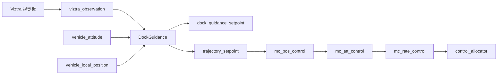
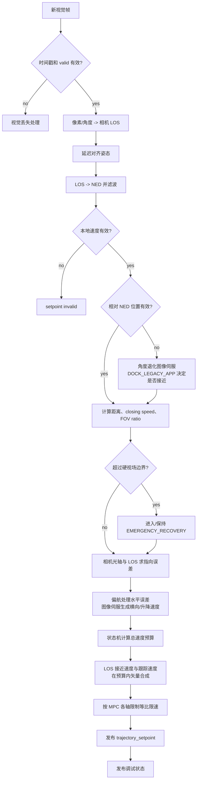
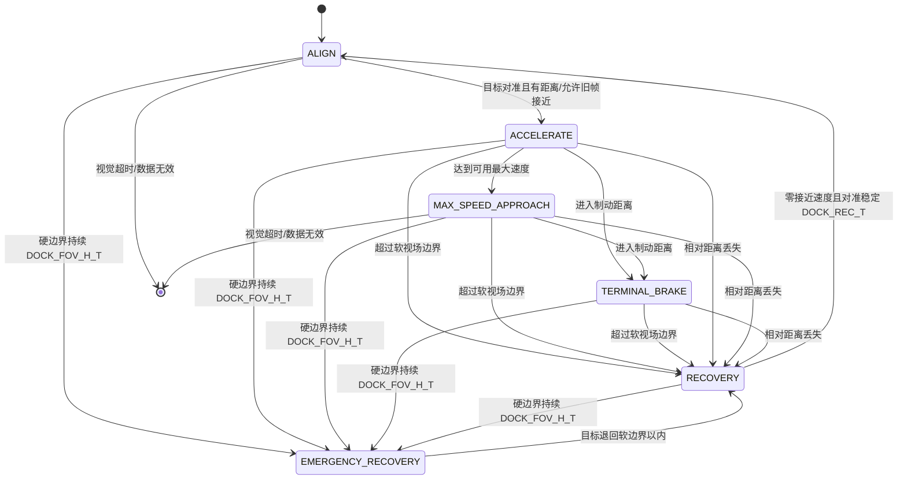
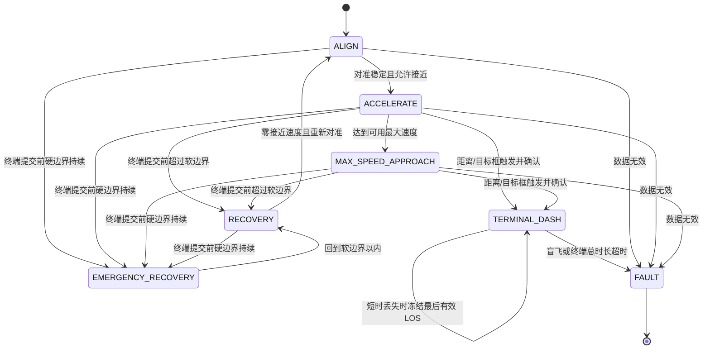
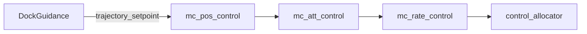

# Dock Guidance 代码逻辑流程图

本页给出当前 `src/modules/dock_guidance` 实现。`TERMINAL_DASH`、终端计时器和有界盲飞已经写入源码；真实接触/对接完成输入仍为后续接口。

## 总体数据流



DockGuidance 不再直接把接近速度误差加到油门。它生成 NED 三维速度设定值，推力、高度和姿态耦合由 PX4 标准多旋翼位置控制器处理。

## 单帧处理



## 当前已实现状态机



| 阶段 | 主要行为 |
|---|---|
| `ALIGN` | 偏航对准目标，图像伺服低速平移消除偏差 |
| `ACCELERATE` | 增加总速度预算；LOS 接近和图像跟踪共同使用该预算 |
| `MAX_SPEED_APPROACH` | 最终三维速度模长保持 `DOCK_VEL_MAX`，图像修正不叠加额外速度 |
| `TERMINAL_BRAKE` | 按剩余距离和 `DOCK_DEC_MAX` 生成制动速度包络 |
| `RECOVERY` | 视场软边界或短时断流时将速度指令减到零 |
| `EMERGENCY_RECOVERY` | 目标越过硬边界但仍可见时快速停止接近并继续跟踪，不触发 RTL |
| `TERMINAL_DASH` | 锁存末段；保持最大三维速度预算，视觉有效时继续修正方向，短时丢失时冻结最后速度向量 |

`TERMINAL_BRAKE` 和普通视觉丢失减速仍用于终端提交之前；进入 `TERMINAL_DASH` 后不再应用这些减速逻辑。

## 当前状态机：最大速度终端冲刺



| 阶段 | 目标行为 |
|---|---|
| `TERMINAL_DASH` | 锁存终端状态；三维速度预算保持最大值，不进入距离制动或 FOV 降速 |
| `FAULT` | 本地控制状态失效、视觉盲飞超时或终端总时长超时 |

目标框尺寸只负责触发终端提交：

```text
target_size = max(target_width_px / DOCK_RES_X,
                  target_height_px / DOCK_RES_Y)
terminal_candidate = relative_distance <= DOCK_TERM_DIST
                     or target_size >= DOCK_TERM_SIZE
enter_terminal = terminal_candidate 持续 DOCK_TERM_CFM
```

进入 `TERMINAL_DASH` 后状态必须锁存，不能因为目标框或距离抖动退回普通接近阶段。视觉有效时继续更新 LOS；目标在极近距离充满画面并丢失后，冻结最后有效 LOS、图像修正和航向，在 `DOCK_TERM_BLIND` 内继续最大速度。`DOCK_TERM_MAX_T` 是防止无限终端飞行的总时长上限，不是成功判据。

## 三维最大速度合成

```text
pointing_error = camera_forward - LOS * dot(LOS, camera_forward)
v_track = -distance * DOCK_IMG_P * pointing_error
|v_track| <= min(DOCK_IMG_VMAX, DOCK_IMG_FRAC * speed_budget)
v_close_cmd = sqrt(speed_budget^2 - |v_track|^2)
v_sp = v_close_cmd * LOS + v_track

normal speed_budget = min(DOCK_VEL_MAX, controller_axis_limits)
legacy speed_budget = min(DOCK_VEL_MAX, DOCK_LEG_VMAX,
                          controller_axis_limits)
terminal speed_budget = 当前模式允许的最大 speed_budget
```

机体偏航直接修正能够由 yaw 消除的水平指向误差；平移图像伺服只处理剩余误差，通常表现为固定镜头在加速倾斜时所需的升降修正。这样不会让平移控制与偏航控制互相对抗。

`v_track` 始终投影到 LOS 的垂直平面。高速阶段会从同一个总速度预算中为它预留空间，因此目标偏离时接近分量会暂时减小，但最终速度模长不会因图像修正而超过 `DOCK_VEL_MAX`。目标回到中心后，全部速度预算重新用于接近。

旧 21 字节帧没有距离时，`v_track` 改由画面剩余角误差生成。`ALIGN` 中限制到 `DOCK_ALIGN_SPD`；`DOCK_LEGACY_APP=1` 时接近速度仍限制到 `DOCK_LEG_VMAX`。当前参数元数据和控制代码把 `DOCK_LEG_VMAX` 上限固定为 `20 m/s`，所以无距离 `40 m/s` 必须先修改这两处限制。

在发布前，按 `MPC_XY_VEL_MAX`、`MPC_Z_VEL_MAX_UP` 和 `MPC_Z_VEL_MAX_DN` 对整个速度向量等比缩放，不允许下游单独截断各轴后改变进近方向。

### 40 m/s 的含义

`DOCK_VEL_MAX` 和 `DOCK_LEG_VMAX` 表示三维速度模长，不是 NED 单轴速度。目标视线仰角为 60° 时：

```text
三维速度 5 m/s  -> 水平 2.5 m/s，爬升 4.33 m/s
三维速度 40 m/s -> 水平 20 m/s，爬升 34.6 m/s
水平速度 40 m/s -> 三维 80 m/s，爬升 69.3 m/s
```

因此实现三维 `40 m/s` 除了修改 Dock 参数，还要求 `MPC_XY_VEL_MAX >= 20 m/s`、`MPC_Z_VEL_MAX_UP >= 34.6 m/s`，并验证模型或真实飞行器的动力和结构能力。

```text
t_acc = target_speed / DOCK_ACC_MAX
d_acc = target_speed^2 / (2 * DOCK_ACC_MAX)

40 m/s @ 3 m/s^2 -> 13.3 s, 266.7 m
40 m/s @ 8 m/s^2 -> 5.0 s, 100.0 m
```

## 视觉丢失

- 终端提交前短时丢失：进入 `RECOVERY`，按 `DOCK_DEC_MAX` 降低三维速度指令。
- 终端提交前超过 `max(DOCK_OBS_TOUT, DOCK_VIS_GRACE)`：设定值 invalid，持续发布零速度并锁存故障；必须先切离 Dock 才能重新进入。
- `TERMINAL_DASH` 内短时丢失：冻结最后有效速度向量和航向，保持最大三维速度。
- 丢失超过 `DOCK_TERM_BLIND` 或终端持续超过 `DOCK_TERM_MAX_T`：锁存故障并交给系统安全回退。
- 真实接触/对接完成输入尚未接入，不能把计时结束当作对接成功。
- 相对 NED 位置无效：`DOCK_LEGACY_APP=1` 时允许角度跟踪高速接近，否则只能低速对准。
- 本地速度无效：不允许进入/继续 Dock 模式。

## 控制权



Dock 模式需要本地位置、高度、姿态和角速度估计。
