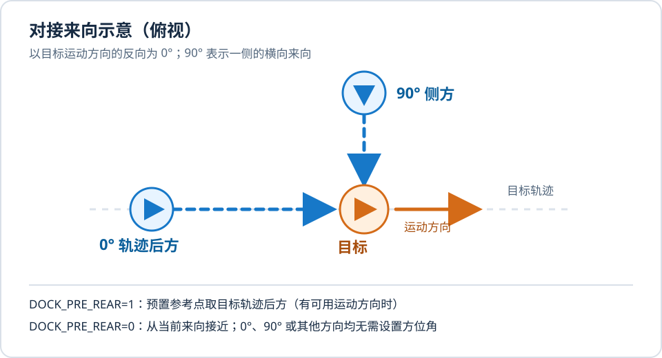
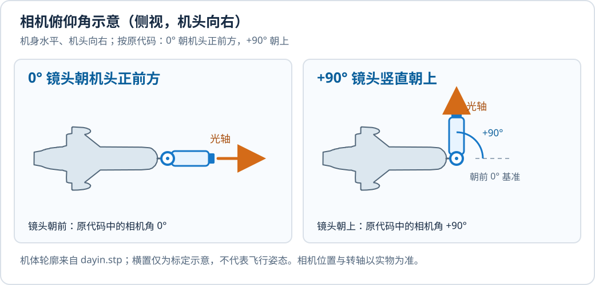

# DockGuidance 用户使用说明

本文按当前 PX4 工作树的 `cuav_7-nano_test` 固件与 `src/modules/dock_guidance` 实现编写，面向接线、参数配置、地面检查、模式使用和日志排查。控制律推导见 [控制律与软件设计](DockGuidance_控制律与软件设计.md)，MT6701 的逐步标定见 [相机角度使用说明](DockGuidance_MT6701_相机角度使用说明.md)，动态相对交会的判据见 [相对运动交会优化](DockGuidance_relative.md)。

## 1. 使用前先选工作路径

DockGuidance 注册名为 **Dock Guidance** 的 PX4 外部模式。进入模式后发布 NED 三维速度和航向设定值，由 PX4 多旋翼位置、姿态和角速度控制器执行。预置阶段可以先使用外部目标位置流，交接后的对接阶段需要持续有效的视觉与本机状态。模块运行或注册成功，不等于可以进入模式；入模前还有视觉/预置、定位和传感器健康检查。

| 场景 | 关键选择 | 所需数据 |
|---|---|---|
| 直接视觉引导，不使用外部目标预置 | `DOCK_PRE_EN=0` | 入模前已有可用的视觉引导设定值；高速接近通常还需目标相对 NED 位置 |
| 先到目标轨迹后方，再切换视觉 | `DOCK_PRE_EN=1`、`DOCK_PRE_REAR=1` | 新鲜的 `viztra_target` 位置与 NED 速度、本机有效全球参考和局部状态；到达后方参考附近且视觉稳定后交接 |
| 从当前位置方向接近目标，再切换视觉 | `DOCK_PRE_EN=1`、`DOCK_PRE_REAR=0` | 同样需要新鲜的 `viztra_target`；沿当前位置接近线向停靠参考点引导，视觉稳定后可在到达前交接 |
| 普通静态控制路径 | `DOCK_DYN_EN=0` | 视觉 LOS；距离用于允许高速接近和末段判定 |
| 静止或运动目标的三维相对交会 | `DOCK_DYN_EN=1`、`DOCK_TERM_EN=1`、`DOCK_PRED_EN=1` | 可信米制尺度：相对 NED 位置，或经标定且未裁剪的目标框宽高；仅有角度不足以确定交会距离 |
| 单轴俯仰相机，用真实角度做坐标变换 | `DOCK_CAM_SERVO=1`、`DOCK_CAM_ENC_EN=1` | 舵机输出、MT6701 的连续 I²C 数据和已标定零位；舵机仍使用视觉误差控制 |

**当前默认值需要特别核对：**`DOCK_PRE_EN=1`、`DOCK_PRE_REAR=1`、`DOCK_TERM_EN=1`、`DOCK_DYN_EN=0`、`DOCK_CAM_ENC_EN=0`。没有 `viztra_target` 时，通常先关闭预置入口；此时若视觉无效，Commander 会拒绝入模。`DOCK_TERM_EN=1` 会启用有时限的末段穿越，其超时是故障，不是对接成功。本文参数表列的是 `module.yaml` 默认值，板级 `param set-default` 和已保存参数可能覆盖它们；飞控上的 `param show` 才是实际值。

## 2. 固件、输入和输出

`boards/cuav/7-nano/test.px4board` 已编入 DockGuidance、Viztra 驱动和 MT6701 驱动，可在源码根目录构建：

```sh
make cuav_7-nano_test
```

产物为 `build/cuav_7-nano_test/cuav_7-nano_test.px4`。刷写后先确认实际固件版本和参数。`DOCK_GUIDANCE=1` 时，启动脚本在 Commander 运行后自动执行 `dock_guidance start`；`SENS_EN_VIZTRA=1` 时，传感器脚本按 `VIZTRA_CFG` 指定的串口启动 `viztra`。`SENS_EN_VIZTRA` 的模块默认值为 `0`，修改后需重启。MT6701 驱动当前需按实际 I²C 总线手动启动，启用 `DOCK_CAM_ENC_EN` 不会自动启动它。

| 输入 | 用户应检查什么 |
|---|---|
| `viztra_observation` | `valid`、`timestamp_sample`、图像偏差 `offset_x/y`、目标框尺寸；扩展帧的 `relative_position_valid` 与 `relative_n/e/d_m` |
| `viztra_status` | 串口帧是否持续收到、有效视觉帧数量、校验/格式错误及连接状态 |
| `viztra_target` | 仅预置路径使用；当前实现要求目标 ID 为 1、来源组件为 25、位置和 NED 速度均有效且新鲜 |
| `vehicle_attitude`、`vehicle_angular_velocity`、`vehicle_local_position` | 机体姿态、角速度、局部位置和速度必须有效；预置还要求有效的全球坐标参考 |
| `sensor_encoder` | 启用 MT6701 后要求已标定、新鲜且角度落在相机行程内 |

主要输出为 `trajectory_setpoint`、`dock_guidance_setpoint`、`dock_guidance_prediction`、`dock_guidance_relative`、`dock_preposition_status`，以及启用舵机时的 `gimbal_controls`。`DOCK_THR>0` 时还会发布固定总油门请求，由下游角速度控制器在末级处理；这是会改变实际高度/制动响应的高级功能。

| 非 Dock 参数/设置 | 当前默认或约束 | 用途 |
|---|---|---|
| `SENS_EN_VIZTRA` | 0；改动需重启 | 是否在传感器启动阶段运行 Viztra 串口驱动 |
| `VIZTRA_CFG` | 启动脚本未配置时选 102 | Viztra 串口选择；须核对该编号在本机实际对应的端口 |
| `VIZTRA_TOUT` | 500 ms；改动需重启 | Viztra 驱动判定最近有效帧的时限 |
| PWM 输出功能 `421` | 由实际输出配置决定 | 将单轴相机舵机接到 `Gimbal Pitch` 功能；核对通道及物理转向 |
| `MNT_MODE_IN` | 建议 `-1` | DockGuidance 直接发布舵机命令时，避免其他 gimbal 发布者同时控制该输出 |
| `MPC_*` 速度、加速度、倾角、推力限制 | 随机型配置 | 仍会限制 Dock 命令的可执行速度和制动能力 |

Viztra 的 `timestamp_sample` 是完整串口帧接收时刻。`DOCK_CAM_DLY` 表示曝光到该时刻的延迟；机体历史和相机角度历史都按曝光时刻查询。像素模式下 `offset_x` 向右为正、`offset_y` 向上为正；`relative_n/e/d_m` 属于 NED 坐标，D 向下为正。`VIZTRA_TOUT` 是驱动状态的有效期限，`DOCK_OBS_TOUT` 是 DockGuidance 控制观测超时，两者用途不同。

## 3. 首次配置与地面检查

### 3.1 核对数据源和工作路径

先确认 Viztra 实际串口及协议，再设置 `SENS_EN_VIZTRA=1` 和相应 `VIZTRA_CFG`、保存参数并重启。不要仅凭默认串口编号推断接线。启动后执行：

```sh
param set SENS_EN_VIZTRA 1
param save
reboot
```

若所接串口不是当前 `VIZTRA_CFG` 指向的端口，应先按该板的串口映射设置 `VIZTRA_CFG`，再保存并重启。重启后检查：

```sh
viztra status
listener viztra_status -n 5
listener viztra_observation -n 5
dock_guidance status
```

若没有外部 `viztra_target` 数据，在**尚未进入 Dock 模式**时设置 `DOCK_PRE_EN=0`；此时入模检查依赖已经生成的有效视觉设定值。`viztra_observation.valid=1` 是输入条件之一，还需通过时间戳、姿态/速度和相机历史检查。若视觉一直为 `valid=0`，关闭预置不能让模式变得可进入。

```sh
param set DOCK_PRE_EN 0
param save
```

以上两行仅用于**没有外部目标流**的直接视觉路径。有新鲜外部目标流，且希望从当前位置方向接近时，使用下列配置：

```sh
param set DOCK_PRE_EN 1
param set DOCK_PRE_REAR 0
param show DOCK_PRE_DIST
param save
```

`DOCK_PRE_REAR=0` 的任意方向预置需要包含该接近线逻辑的固件。`DOCK_PRE_DIST` 默认 100 m，可按场景核对后再修改已有保存值。它是无视觉时相对目标的**水平参考间距**，不是最终对接距离。距离大于该值时，参考点位于当前位置到预测目标位置的连线上；已经在该距离内时，参考点取本机当前位置，不再主动向目标水平靠近。移动目标仍有目标速度前馈，实际刹停和间距需看本机跟踪结果。预置过程中，新鲜视觉连续满足 `DOCK_PRE_VIS_T` 即可交接，无需先到达参考点；视觉始终无效时不会直接按外部目标坐标穿越。



图中 0° 和 90° 只是说明来向的相对方位：以目标运动方向的反向为 0°，侧方为 90°。它们不是需要设置的飞控角度参数。`DOCK_PRE_REAR=0` 按本机实际位置计算接近线；目标静止且没有历史运动方向时，`DOCK_PRE_REAR=1` 也会使用本机到目标的接近线作为后方参考方向。图中虚线只示意几何方向，不代表实际飞行轨迹或视觉交接已经满足条件。

任意方向预置入模仍要求 `viztra_target` 的目标 ID 为 1、来源组件为 25、位置及 NED 速度有效且在 `DOCK_PRE_TOUT` 内，同时本机局部位置/速度和全球参考有效。视觉交接后还要按视觉路径的距离、视场与控制限制执行。地面或 HIL 验证时观察：

```sh
listener viztra_target -n 5
listener dock_preposition_status -n 5
listener viztra_observation -n 5
listener dock_guidance_setpoint -n 5
```

预置中 `dock_preposition_status.state=2` 表示跟随参考点，`state=7` 表示已到参考点等待视觉；查看 `target_valid`、`reference_valid`、`reference_reached`、`visual_wait_s`、`target_age_s`、`reference_position_ned`、`guidance_position_ned` 与 `vehicle_position_ned`。`bypass_active=1` 表示正在绕开目标或匹配目标速度。`state=4` 表示已交接，随后 `dock_guidance_setpoint.stage` 应进入 `ALIGN`。`visual_stable=0` 或 `viztra_observation.valid=0` 时不能把已入模当作已具备视觉对接条件。

```sh
param show DOCK_GUIDANCE
param show DOCK_PRE_EN
param show DOCK_PRE_REAR
param show DOCK_PRE_DIST
param show DOCK_PRE_TOUT
param show DOCK_DYN_EN
param show DOCK_TERM_EN
param show DOCK_CAM_SERVO
param show DOCK_CAM_ENC_EN
```

### 3.2 校准相机和确认距离

固定相机需核对 `DOCK_CAM_ROLL/PITCH/YAW` 与真实安装方向。单轴舵机需设置实际 PWM 输出为 `Gimbal Pitch (421)`，检查 `DOCK_CAM_P_MIN/MAX` 对应行程；PWM 通道反向与编码器方向是两件事。按原代码的相机角定义，机身水平时，舵机命令 0° 使镜头朝机头正前方，+90° 使镜头朝上。`DOCK_CAM_PITCH` 是初始命令角；模块默认 0° 对应朝前，MicoAir H743 Dock 的板级默认值改为 90°。CUAV 板级脚本包含 `PWM_AUX_FUNC1=421` 和 `DOCK_CAM_SERVO=1`；仍需核对实际固件参数和输出。

无编码器且相机实际行程不是默认 0°～90° 时，按 [无编码器舵机标定](DockGuidance_无编码器舵机标定.md) 测量光轴角/PWM 对应关系；`DOCK_CAM_OUT_LO/HI` 可分别设置行程两端的归一化输出，默认 `-1/+1` 保留旧映射。MicoAir H743 Dock 的 ES08MA 采用 1:1 传动，PWM5 实测端点为 90°/1500 μs 和 30°/2100 μs；启动角为 90°，软件下限为 30°。

若接入 1:1 传动的 MT6701，先在未解锁状态按 [MT6701 相机角度使用说明](DockGuidance_MT6701_相机角度使用说明.md) 启动 I²C 驱动、执行 `dock_guidance calib_zero`、核对正向角和约 90° 的计数变化，再启用 `DOCK_CAM_ENC_EN=1`。0° 需要标定，90° 只作核对；编码器只用于相机到机体坐标变换，不改变舵机命令。



图中机体轮廓取自 `dayin.stp` 的 X–Z 侧视投影，已按实际机头方向翻转为机头向右。机身长轴水平摆放仅为说明角度基准，不表示穿越机的飞行姿态；相机安装位置和转轴仅作示意。按原代码的相机坐标定义，镜头朝机头正前方为相机角 0°，向上抬至竖直为 +90°。编码器测量的是相机相对机体的角度，因此飞行中机体俯仰后，0° 不一定对地水平。实物零位应在朝前的 0° 位置执行 `dock_guidance calib_zero`，并核对舵机与编码器正向。这里的 0°/90° 与前文俯视图中的目标接近来向无关。

观察 `viztra_observation.relative_position_valid`。`DOCK_LEGACY_APP=0`（默认）时，静态路径缺少有效相对 NED 位置会停留在对准阶段，不会按高速接近参数加速。`DOCK_LEGACY_APP=1` 可允许仅角度接近，但受 `DOCK_LEG_VMAX` 限制，而且没有可靠米制距离供末段控制。动态相对交会需要可信尺度和多帧相对变化率，不能从单帧目标框或仅角度推断真实三维距离。

### 3.3 入模前和入模后

1. 在地面核对目标方向、相机角、舵机行程、本机位置/速度有效性和所有实际参数；先在受控低速场景验证视觉方向与限幅，再考虑高速参数。
2. 执行 `dock_guidance status`，确认 `Dock mode: registered`、视觉状态正常、无故障锁存。若启用编码器，确认 `ready=1`、`fault=0`、样本年龄连续更新。
3. 在支持该外部模式的飞行模式界面中选择 **Dock Guidance**。模式 ID 由 Commander 注册返回，不应在脚本中写死。入模成功后 `dock_guidance status` 的 `active` 变为 `yes`；`listener dock_guidance_setpoint -n 5` 的 `valid` 和 `stage` 用于确认当前引导状态。
4. 不使用预置时，视觉先进入 `ALIGN`；目标在对准区内保持 `DOCK_ALIGN_T` 后，才可能加速。有预置时先进入 `PRE_POSITION`：`DOCK_PRE_REAR=1` 跟随轨迹后方参考点，`0` 跟随当前位置接近线上的参考点；交接后进入视觉 `ALIGN`。运行中不要临时修改预置方向、相机几何、编码器零位或动态路径开关；这些会改变参考路径或清理历史。
5. 退出或发生故障后，先看飞行模式、`fault_latched` 和日志。真实视觉故障锁存后，须由驾驶员明确切换到其他模式，才会清除再次入模的锁存；不可依靠持续保持 Dock 开关自动反复重入。

## 4. 阶段和退出语义

| `stage` | 阶段 | 对操作者的含义 |
|---:|---|---|
| 0 | `NONE` | 无有效引导设定值 |
| 1 | `ALIGN` | 低速图像/航向对准，等待稳定条件 |
| 2、3 | `ACCELERATE`、`MAX_SPEED_APPROACH` | 加速并在总速度、各轴速度、加速度和视场约束内接近 |
| 4 | `TERMINAL_BRAKE` | `DOCK_TERM_EN=0` 等路径的目标前制动阶段 |
| 5、6 | `RECOVERY`、`EMERGENCY_RECOVERY` | 软/硬视场边界或数据退化后的恢复，不表示对接完成 |
| 7 | `TERMINAL_DASH` | 已提交有界末段穿越；可能短时保持最后速度，受盲飞和总时限约束 |
| 8 | `PASS_PREDICTED` | 估计穿越目标平面，进入通过后制动；**不是接触或对接成功传感器** |
| 9、10 | `STARTUP_CLIMB`、`TRACK_CAPTURE` | 动态路径的启动高度/目标捕获阶段 |
| 11 | `PRE_POSITION` | 使用外部目标位置流预置；参考点由 `DOCK_PRE_REAR` 选择轨迹后方或当前位置接近线 |

`DOCK_TERM_EN=1` 默认允许最大速度末段流程，不按 `DOCK_STOP_DIST` 提前停车。静态与动态路径的末段判据不同：静态路径可由距离或目标框比例触发 `TERMINAL_DASH`，超时会故障；三维相对交会路径还检查可达性、误差界和冻结速度穿越预测。任何 `PASS_PREDICTED` 或最近距离数字都只是估计，当前没有物理接触确认输入。

`DOCK_EXIT_MODE=0` 选择制动后 RTL，`1` 选择 Hold。正常通过后，模块要求新鲜有效的本机三维速度低于 0.5 m/s 且连续保持 0.5 s，才向 Commander 请求目标模式。故障时 Commander 先接管；选 Hold 也须满足停车条件后才请求 Hold。定位或速度无效时，不能把没有切到 Hold 解释为故障已经消除。

## 5. 参数速查

以下数值是模块元数据默认值。单位和允许范围以 [module.yaml](../src/modules/dock_guidance/module.yaml) 及飞控实际 `param show` 为准；板级 `set-default`、用户保存值会覆盖表中默认。相机编码器参数的范围、方向和标定步骤详见 [MT6701 专页](DockGuidance_MT6701_相机角度使用说明.md)。

### 启动、外部目标与预置

| 参数 | 默认 | 作用 |
|---|---:|---|
| `DOCK_GUIDANCE` | 1 | 开机启动 DockGuidance 模块 |
| `DOCK_PRE_EN` | 1 | 入模先走外部目标预置；无 `viztra_target` 时通常设为 0 |
| `DOCK_PRE_DIST` | 100 m | 后方路径上的参考距离，或任意方向路径的水平参考间距；无视觉时减速趋向该参考点 |
| `DOCK_PRE_WAIT_T` | 2 s | 到达后方或停靠参考点后，等待有效视觉的最长时间；超时按故障退出 |
| `DOCK_PRE_CLEAR_D` | 50 m | 后方路径对外部目标的最小水平绕行距离；无法安全绕行则故障退出 |
| `DOCK_PRE_REAR` | 1 | 1：沿轨迹到后方参考点再交接；0：从当前位置方向到停靠参考点再交接 |
| `DOCK_PRE_RADIUS` | 250 m | 预置路径水平转弯半径下界 |
| `DOCK_PRE_YAW_R` | 30°/s | 预置阶段朝向预测目标的航向设定值变化率上限；视觉交接后使用 `DOCK_YAW_RATE` |
| `DOCK_PRE_ZOFF` | 0 m | 预置参考点相对目标轨迹的高度偏置；任意方向路径在停靠距离内默认取本机当前位置，启动爬升仍可调整高度 |
| `DOCK_PRE_VIS_T` | 0.3 s | 视觉连续有效达到此时间后允许交接 |
| `DOCK_PRE_TOUT` | 800 ms | 外部目标位置/速度流的超时门槛，适配约 2 Hz 输入；已有保存值需手动确认 |
| `DOCK_PRE_PRED_T` | 1 s | 外部目标运动外推时间上限 |

### 相机、视觉与传感器

| 参数 | 默认 | 作用 |
|---|---:|---|
| `DOCK_CAM_DLY` | 0 ms | 曝光到 Viztra 帧接收时间的延迟，供历史对齐；不表示舵机机械延迟 |
| `DOCK_OBS_TOUT` | 150 ms | Dock 视觉帧超时门槛；与 `VIZTRA_TOUT` 不同 |
| `DOCK_CAM_ROLL/PITCH/YAW` | -90/0/0° | 相机到机体安装角；固定相机的 PITCH=0° 指朝前，启用舵机时 PITCH=0° 是初始命令角、指朝前；启用编码器后实测角替代 PITCH 分量 |
| `DOCK_CAM_SERVO` | 0 | 启用单轴俯仰视觉舵机控制 |
| `DOCK_CAM_ENC_EN` | 0 | 用 MT6701 实测角计算相机到机体旋转；不参与舵机控制 |
| `DOCK_CAM_ENC_Z` | -1 count | 相机机体相对 0° 时的原始计数；-1 表示未标定 |
| `DOCK_CAM_ENC_REV` | 0 | 反转测量角符号，不反转 PWM |
| `DOCK_CAM_P_MIN/MAX` | 0/90° | 舵机行程端点，同时给编码器角度合理性检查定界 |
| `DOCK_CAM_OUT_LO/HI` | -1/+1 | 行程低/高角度对应的归一化 `Gimbal Pitch` 输出；无编码器时按实测光轴角与 PWM 标定 |
| `DOCK_CAM_P_RATE` | 5°/s | 舵机命令角变化率上限 |
| `DOCK_CAM_P_TC` | 2 s | 图像俯仰误差到舵机转速的时间常数 |
| `DOCK_CAM_P_DB` | 0.5° | 舵机俯仰误差死区 |
| `DOCK_FILT_HZ` | 2 Hz | 常规 LOS 向量滤波截止频率 |
| `DOCK_RES_X/Y` | 1920/1080 px | 图像宽/高；像素偏差换角度时使用 |
| `DOCK_FOV_X/Y` | 60/45° | 相机水平/垂直视场，影响 LOS 与边界比 |
| `DOCK_LOS_MAX` | 89° | 相机 LOS 角的有效范围上限 |
| `DOCK_REL_TOUT` | 200 ms | 相对 NED 位置有效期 |

### 静态接近、视场与速度

| 参数 | 默认 | 作用 |
|---|---:|---|
| `DOCK_VEL_MAX` | 15 m/s | 正常接近的三维速度预算；仍受 PX4 各轴、推力和 FOV 限制 |
| `DOCK_ACC_MAX` | 3 m/s² | 接近速度命令的加速度上限 |
| `DOCK_DEC_MAX` | 3 m/s² | 接近/恢复速度命令的减速度上限 |
| `DOCK_STOP_DIST` | 2 m | 关闭末段穿越时的目标前停车距离 |
| `DOCK_ALIGN_T` | 1 s | 对准条件连续成立的时间 |
| `DOCK_ALIGN_SPD` | 1 m/s | 对准阶段的平移速度上限 |
| `DOCK_FOV_ALIGN/SOFT/HARD` | 0.30/0.65/0.85 | 以半视场为基准的对准/软恢复/硬边界比例 |
| `DOCK_FOV_H_T` | 0.15 s | 硬边界连续确认时间 |
| `DOCK_REC_T` | 1 s | 恢复后重新对准所需的稳定时间 |
| `DOCK_IMG_P` | 0.3 1/s | 固定相机图像指向误差到跟踪速度的增益 |
| `DOCK_IMG_VMAX` | 1 m/s | 图像平移修正的速度上限 |
| `DOCK_IMG_FRAC` | 0.40 | 图像修正最多占总速度预算的比例 |
| `DOCK_LEGACY_APP` | 0 | 允许旧帧无距离、仅角度接近 |
| `DOCK_LEG_VMAX` | 5 m/s | 仅角度接近时的速度上限 |
| `DOCK_YAW_DB` | 1° | 水平图像误差的航向死区 |
| `DOCK_YAW_RATE` | 10°/s | 航向设定值的变化率上限 |
| `DOCK_VIS_GRACE` | 300 ms | 普通视觉短时丢失的降级宽限，超过则引导失效 |

### 动态、预测与末段

| 参数 | 默认 | 作用 |
|---|---:|---|
| `DOCK_DYN_EN` | 0 | 动态/米制目标路径开关；与 TERM、PRED 同开时使用相对交会 |
| `DOCK_PRED_EN` | 1 | 三维预测修正；与 DYN、TERM 同开时启用相对交会路径 |
| `DOCK_PRED_TAU` | 0.5 s | 飞机速度响应模型时间常数，应从命令与实速日志辨识 |
| `DOCK_PRED_TMAX` | 5 s | 交会预测最大时间窗 |
| `DOCK_PRED_ANG` | 15° | 预测修正允许的速度方向偏角上限 |
| `DOCK_CAP_PRED_T` | 2 s | 捕获阶段的最大预测时间 |
| `DOCK_PRED_CFM` | 0.2 s | 预测证据连续确认时间 |
| `DOCK_BLIND_TGO` | 0.35 s | 新提交短时盲穿前的最大预计过平面时间 |
| `DOCK_TGT_W/H` | 0/0 m | 目标真实投影宽/高；无相对位置时为目标框尺度估计提供标定 |
| `DOCK_SIZE_ERR` | 0.15 | 目标尺寸的相对系统误差下限 |
| `DOCK_EST_ACC` | 3 | 目标加速度过程噪声，用于估计不确定度 |
| `DOCK_EST_VMAX` | 60 m/s | 目标速度估计异常值的拒绝门槛 |
| `DOCK_EST_VERR` | 3 m/s | 目标速度估计允许误差上限 |
| `DOCK_MATCH_ERR` | 2 m/s | 旧目标跟随分支开始接近前的速度匹配误差 |
| `DOCK_REL_VMAX` | 10 m/s | 目标相对接近速度上限；稳定几何捕获仍可能使用 `DOCK_VEL_MAX` 可行预算 |
| `DOCK_DYN_JERK` | 8 m/s³ | 动态速度命令 jerk 上限 |
| `DOCK_PASS_ERR` | 3 m | 预测穿越的误差/不确定度门槛；不是实物保证 |
| `DOCK_PASS_DIST` | 2 m | 判断越过目标平面的预计距离 |
| `DOCK_TERM_EN` | 1 | 启用有时限末段穿越，不按 `DOCK_STOP_DIST` 提前停车 |
| `DOCK_TERM_DIST` | 0 m | 静态末段的距离触发阈值；0 禁用该触发 |
| `DOCK_TERM_SIZE` | 0.10 | 目标框占画面尺寸比例的静态末段触发阈值 |
| `DOCK_TERM_CFM` | 0.05 s | 末段进入条件连续确认时间 |
| `DOCK_TERM_BLIND` | 0.50 s | 末段视觉丢失后允许的保持上限，另受总时限约束 |
| `DOCK_TERM_MAX_T` | 1.5 s | 末段总时长上限；超时是故障，不是成功 |
| `DOCK_TERM_FILT` | 10 Hz | 末段 LOS 滤波截止频率 |
| `DOCK_START_H` | 10 m | 已起飞的动态路径入模后相对当前高度的启动爬升增量；0 禁用 |
| `DOCK_CAP_VMAX` | 3 m/s | 米制尺度/捕获证据未充分成立时的捕获速度上限；0 禁用主动捕获 |

### 油门、通过后制动与退出

| 参数 | 默认 | 作用 |
|---|---:|---|
| `DOCK_THR` | 0 | 0 禁用固定总油门；大于 0 时请求末级归一化总油门，会改变高度响应 |
| `DOCK_THR_RATE` | 0.2/s | 固定油门和通过后制动油门的变化率上限 |
| `DOCK_BRK_EN` | 1 | 通过后/故障 RTL 的推力保持制动开关 |
| `DOCK_BRK_THR` | 0.35 | 制动总油门下限，仍受 MPC 推力上限约束 |
| `DOCK_BRK_TMIN` | 0.70 | 高速制动时的末级归一化总油门最低值 |
| `DOCK_BRK_TVEL` | 8 m/s | 水平速度低于此值后解除 `DOCK_BRK_TMIN` 地板 |
| `DOCK_BRK_RATE` | 45°/s | 制动倾角命令变化率上限 |
| `DOCK_BRK_VEL` | 10 m/s | 达到/超过该水平速度时采用完整制动倾角权重 |
| `DOCK_REC_YAW_V` | 2 m/s | 恢复制动时保持航向，三维速度低于此值后释放航向 |
| `DOCK_EXIT_MODE` | 0 | 0=RTL、1=Hold；通过后停车满足条件才请求；故障先由 Commander 接管 |

## 6. 状态、日志与常见问题

```sh
dock_guidance status
listener dock_guidance_setpoint -n 5
listener dock_guidance_prediction -n 5
listener dock_guidance_relative -n 5
listener dock_preposition_status -n 5
listener vehicle_local_position -n 5
listener vehicle_status -n 5
```

`dock_guidance status` 给出注册、激活、视觉有效性、故障锁存、距离、FOV、速度和相机角。`dock_guidance_setpoint.valid` 是当前引导是否可用；`velocity_valid` 和 `relative_position_valid` 分别指本机速度与目标距离；`fov_ratio` 接近 1 表示目标逼近视场边缘。`camera_mount_pitch_deg` 是命令角，`sample_mount_pitch_deg` 是曝光时刻坐标变换实际使用的角；启用 MT6701 时后者来自实测角。

| 现象 | 先查什么 |
|---|---|
| 未看到 Dock Guidance 模式 | `DOCK_GUIDANCE`、`dock_guidance status` 的 `registered`、启动脚本和 Commander 状态 |
| Viztra 连接正常但 Dock 视觉无效 | `viztra_status.observation_valid`、`viztra_observation.valid`、时间戳、画面目标及 `DOCK_OBS_TOUT`；有串口帧不等于有有效观测 |
| `DOCK_PRE_EN=0` 后不能进入模式 | 看 `viztra_observation.valid` 与 `protocol_status`、`dock_guidance_setpoint.valid`；`protocol_status=0x00` 表示有效位 `0x01` 未置位，即使持续收到帧也不能生成直接视觉入口。状态位 `0x02` 置位也表示跟踪停止 |
| 使用预置仍不能进入模式 | 看 `viztra_target` 目标 ID/来源、位置和速度有效位、`DOCK_PRE_TOUT`，以及本机局部位置/速度和全球参考；再看 `fault_latched`，启用编码器时还需 `ready=1` |
| `DOCK_PRE_REAR=0` 仍飞向轨迹后方 | 核对已刷入包含当前位置接近线逻辑的固件、实际 `param show DOCK_PRE_REAR`，以及 `dock_preposition_status.reference_position_ned` |
| 停留在 `PRE_POSITION` | 看 `dock_preposition_status.target_valid/reference_valid/visual_stable/state`；目标流失效检查时效，视觉无效检查画面目标和 Viztra 锁定状态 |
| 停留在 `ALIGN` | 目标是否处在 `DOCK_FOV_ALIGN` 内且持续 `DOCK_ALIGN_T`，是否有有效相对距离；舵机是否在行程端且画面仍偏离 |
| 相机角或目标方向错误 | 安装角 `DOCK_CAM_ROLL/YAW`、编码器零位/反向、`camera_time_aligned`、`DOCK_CAM_DLY`；同时检查 PWM 反向是否只影响舵机 |
| 接近速度低于 `DOCK_VEL_MAX` | `capture_speed_limit`、`DOCK_LEG_VMAX`、目标尺度/估计、FOV、MPC 各轴速度/加速度和推力限幅；命令速度与实速分开比较 |
| 视觉丢失后退出 | 普通阶段查 `DOCK_VIS_GRACE` 和 `DOCK_OBS_TOUT`；末段另查 `DOCK_TERM_BLIND`、`DOCK_TERM_MAX_T` 和预测拒绝原因 |
| 通过后未切 Hold/RTL | 是否真的进入 `PASS_PREDICTED`、本机速度和位置是否新鲜、三维速度是否连续低于 0.5 m/s 达 0.5 s |

ULog 至少对照 `viztra_observation`、`viztra_status`、`dock_guidance_setpoint`、`dock_guidance_prediction`、`dock_guidance_relative`、`dock_preposition_status`、`trajectory_setpoint`、`vehicle_local_position`、`vehicle_status`；启用编码器再查 `sensor_encoder`。`sensor_encoder` 在日志配置中是可选话题，分析前先确认实际 ULog 中存在。要判断执行能力，还需比较位置控制器设定、姿态、推力和执行器输出；只看 Dock 的速度命令不足以证明飞机达到该速度。

源码构建和独立算法回归只能检查接口与局部计算。本文所列的视场、预测、油门和制动行为仍需按实际硬件接线、地面数据、HIL 与飞行日志分别验证；预测穿越与物理对接成功应分别记录。
