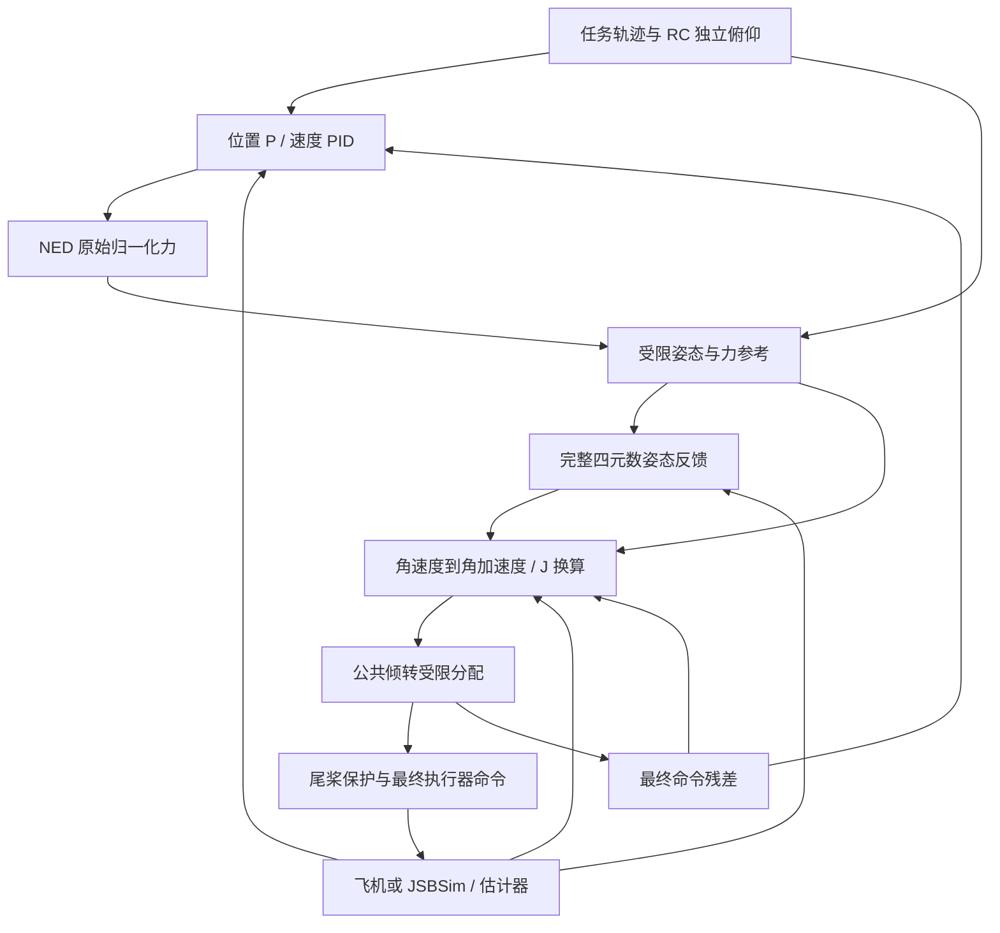

# Voliro T 控制律与算法设计方案

版本：2026-11-03；依据当前工作区源码，包含 ±160° 扩展与 UDP 姿态显示修改。
配套文档：[软件设计方案](VoliroT_software_design.md)、[实现与验证记录](VoliroT_large_angle_control.md)。

## 1. 设计对象与当前结论

对象是四个前部同轴电机、一个可反转尾电机、一套公共倾转机构的五电机构型，
不是每个旋翼独立倾转的全驱动构型。前四电机共享倾角；机体 Y 方向没有独立的推力通道。

采用 PX4 的任务、估计器、位置/速度级联、姿态/角速度级联和独立控制分配架构。
对 Voliro 的修改集中在力到姿态映射、参考生成、姿态增益坐标、角加速度控制及受限分配。
当前方案是“完整四元数姿态反馈 + 机体系动力学角速度环 + 公共倾转解析分配”，
未实现完整 SE(3) 全状态控制，也没有给出带全部饱和和切换的全局稳定性证明。

| 项目 | 当前实现状态 |
| --- | --- |
| 独立机体俯仰目标 | ±160°，与 bank 分开限制 |
| 公共倾转映射 | 飞控默认范围与 JSBSim 模型均为 ±160° |
| 姿态反馈 | 完整四元数误差，任务轴增益随姿态映射 |
| 角速度反馈 | 角加速度单位 PID、惯量换算、刚体交叉项 |
| 执行器约束 | 电机上下限、舵机角度/速率、尾桨反转保护、限位恢复优先 |
| 验证 | 已有主机回归、原生 JSBSim 闭环及固件构建证据 |
| 板上验收 | 新模式匹配参数后的 HIL、时延和实机标定仍待完成 |

`VT_CTRL_MODE=0` 是旧分支，仍为默认；`=1` 且 `CA_AIRFRAME=17` 才启用新动力学控制。
±160° 是目标和模型行程范围，不代表任意外力、载荷和动作速率下都具有足够控制余量。

## 2. 与 PX4 的对应关系

PX4 官方的[控制架构说明](https://docs.px4.io/main/en/flight_stack/controller_diagrams)
给出位置、速度、姿态、角速度的级联组织方式；
[控制分配说明](https://docs.px4.io/main/en/concept/control_allocation)
说明控制器输出与具体电机/舵机几何映射的分工。本设计沿用该分层。

官网 main 会持续更新，可能包含本地分支尚未具备的参考模型和参数。
下面的逐项对照以本仓库源码为准，不将官网当前参数直接视为本机已实现参数。

| 层级 | 本仓库普通 MC 路径 | Voliro 新模式 |
| --- | --- | --- |
| 任务与估计 | Commander / Navigator / FlightModeManager / EKF2 | 复用；任务航向在新模式下使用力平面定义 |
| 位置/速度 | 位置 P、速度 PID、前馈及推力抗饱和 | 保留级联；使用 VPC 增益，增加下游残差幅值回算 |
| 加速度到推力 | 倾斜机体推力轴生成姿态与集体推力 | 输出自由方向的 NED 力；bank 满足横向力，独立 pitch 交给共倾分配 |
| 姿态 | 四元数反馈，普通 MC 包含 reduced-attitude/yaw 权重处理 | wrapper 固定使用完整四元数误差；任务坐标增益 + 全角速度前馈 |
| 角速度 | 归一化力矩 PID、测量加速度 D 项 | 先算角加速度，再用 J 换成 Nm，最后归一化 |
| 分配 | 几何相关的力矩/推力到执行器映射 | Fx/Fz/My 联合解、滚转/航向模态解、尾桨保护预演 |

源码对照：[MC 位置环](../src/modules/mc_pos_control/PositionControl/PositionControl.cpp)、
[MC 姿态环](../src/modules/mc_att_control/AttitudeControl/AttitudeControl.cpp)、
[MC 角速度核心](../src/lib/rate_control/rate_control.cpp)。

## 3. 坐标、符号与单位

- 导航系 N：NED，X 北、Y 东、Z 下；机体系 B：FRD，X 前、Y 右、Z 下。
- `q` 使用 Hamilton 四元数，顺序 w,x,y,z；`R(q)` 将 B 向量转到 N。
- 机体系角速度为 `ω_B=(p,q,r)`，单位 rad/s；其三个分量不是三个欧拉角的时间导数。
- `F_N` 为实际力，单位 N；`f_N=F_N/Fmax` 为归一化力。
- `τ_B` 为实际力矩，单位 Nm；`uτ=τ_B/Sτ` 为逐轴归一化力矩。
- `J=diag(Jx,Jy,Jz)` 使用机体系 kg m²；当前实现不包含非对角惯量。
- β 为力平面横向 bank，θ 为独立机体 pitch，ψ 为力平面 heading，α 为公共舵机倾角。
  **θ 和 α 是不同变量**：前者为姿态参考，后者由力/力矩分配决定。

归一化定义：

```text
Fmax = 4*CA_CT_TMAX + CA_CT_T5MAX
Sτ   = diag(VEC_TQ_R, VEC_TQ_P, VEC_TQ_Y)
F_B  = Fmax * R(q)^T * f_N
τ_B  = Sτ * uτ
```

反向尾桨最大推力单独标定，不改变上述 Fmax。`actuator_motors.control[i]` 是电机命令，
不等于整机归一化推力、RPM 或实测推力。

### 3.1 90° 附近发生的变化

机体惯量不会在俯仰 90° 时交换。变化的是任务轴到机体轴的投影，以及执行器产生力矩的方式。
若在导航系表示惯量，则 `J_N=R J R^T` 随姿态变化，通常包含交叉项。
不能只交换两组 PID 数字来代替这个变换。

在接近正 90° 独立俯仰、bank 较小时，世界航向轴主要投影到机体 −X，横向 bank 轴主要
投影到机体 +Z。负 90° 时相应符号改变。因此固定“机体 Z 就是航向”的调参或滤波会用错物理通道。

## 4. 总体闭环



参考中的 NED 力在角速度环更新时用最新姿态转换为机体系力；不长期沿用位置环较早计算的
机体系分量。姿态/角速度 Offboard 和 Acro 的机体系推力入口仍保留。

## 5. 位置与速度控制

令位置、速度误差分别为 `ep=p_sp-p`、`ev=v_sp-v`。省略逐轴 NAN 门控及限幅时：

```text
v_sp = v_ff + Kp_pos * ep
a_sp = a_ff + Kp_vel * ev + z_v - Kd_vel * measured_acceleration
f_raw = (a_sp - g*e3) * hover_thrust/g
```

实际代码继续执行速度上限、垂直推力优先、水平余量、最小/最大推力和已有 ARW。
正常参考保持世界 NED 推力 Z 为负，不要求倾斜后机体推力 Z 一直为负。

位置控制实际增益是 `VPC_XY_P`、`VPC_Z_P`、`VPC_*_VEL_*_ACC`。
`MPC_*` 中仍有共享任务约束和悬停推力，但修改 `MPC_XY_VEL_P_ACC` 不等于修改本机 vector 速度环 P。

定义总 NED 残差：

```text
Δf_N = R(q) * unallocated_thrust_body + (f_raw - f_limited)
```

保留同向饱和时阻止继续积分的门控。新模式还执行：

```text
z_v_next = z_v + Ki_vel * ev_gated * dt
                 - VT_POS_AW * (g/hover_thrust) * Δf_N * dt
```

原有垂直积分限幅、Dock 冻结和制动返回路径仍有效。这里回算的是最终命令模型的残差，
没有把执行器预测值当作实测力。

## 6. 力平面与 ±160° 参考

### 6.1 姿态定义

```text
R_d = Rz(ψ) * Rx(β) * Ry(θ)
F_lateral = -sin(ψ)*F_Nx + cos(ψ)*F_Ny
β_target = clamp(atan2(F_lateral, -F_Nz), -βmax, +βmax)
θ_target = clamp(AUX1, -1, 1) * clamp(VT_PITCH_MAX, 0, 160°)
```

该顺序使独立俯仰不改变机体 Y 轴，从而维持 `R_d^T F_N` 的 Y 分量为零。
`MPC_TILTMAX_AIR` 限制 bank；`VT_PITCH_MAX` 限制 θ，不能用前者代替后者。

从实际四元数提取同一坐标定义：

```text
ψ = atan2(-R[0][1], R[1][1])
β = asin(clamp(R[2][1], -1, 1))
θ = atan2(-R[2][0], R[2][2])
```

bank 必须远离 ±90°。控制参考内部 bank 上限为 80°，典型机架配置为 20°；
这不是任意翻滚的全局无奇异角度表示。完整姿态误差仍在四元数空间计算。

### 6.2 受限参考积分

对各参考轴，用误差 e、速度 v、位置 x、参考频率 wn：

```text
v_des = clamp(feedforward + 0.5*wn*e, -vmax, +vmax)
a = clamp(2*wn*(v_des-v), -amax, +amax)
v_next = clamp(v+a*dt, min(v,v_des), max(v,v_des))
x_next = x + 0.5*(v+v_next)*dt
```

bank 和 pitch 另用剩余距离约束可行制动速度。代码为下一步预留
`v²/(2*amax) + |v|*dt/2` 的停止距离，避免到限位后直接截断速度造成前馈尖峰。
这些连续性约束针对有效固定配置及可行状态；不保证飞行中突变角度上限也无跳变。

独立俯仰追踪权重使用四元数误差角 ε：

```text
pitch_authority = clamp((15°-ε)/10°, 0.2, 1)
```

误差小于约 5° 时保持全速，增大后逐渐减慢独立俯仰；不减慢 bank 稳定响应。
有新鲜且启用的舵机预测时，倾角预测落后也可进一步降低该权重。

±160° 扩展的航向参考权重为：

```text
heading_authority = clamp((θmax-|θ_ref|)/20°, 0.2, 1)
```

它同时缩放航向速度和加速度上限。θmax=160° 时，从 140° 开始降速，在接近端点时
保留 20% 的航向参考速度/加速度。当前权重依赖配置的 pitch 上限；后续可以改成依据真实
舵机余量与可实现力矩的可行性调度，避免小 θmax 配置过度保守。后者尚未实现。

### 6.3 同一受限 bank 对应同一力

参考滤波后重新构造力：保留航向坐标下的纵向力和世界垂直分量，令
`F_lateral_limited=-F_Nz*tan(β_ref)`，再施加总模长上限。
位置积分器接收原始力与受限力之差，避免姿态参考已放慢而位置积分仍按原始力累积。

### 6.4 全角速度与角加速度前馈

定义 `z=e3`、`x=Rz(ψ)e1`、`y=Rz(ψ)Rx(β)e2`：

```text
ω_ref_N = z*ψdot + x*βdot + y*θdot
α_ref_N = z*ψddot + x*βddot + y*θddot
          + (z×x)*ψdot*βdot
          + (z*ψdot+x*βdot)×y*θdot
```

必须保留旋转轴本身变化带来的交叉项。`yaw=NAN` 的速率请求积分受限航向速率，
不反复锁定常规欧拉 yaw。

## 7. 姿态与角速度控制律

### 7.1 完整四元数姿态反馈

```text
q_e = canonical(q^-1 * q_d)
e_q = 2*imag(q_e)
C = R(q)^T * Rz(ψ_ref)
K_task = diag(VT_BANK_P, VT_PITCH_P, VT_HEAD_P)
ω_sp_B = C*K_task*C^T*e_q + R(q)^T*ω_ref_N
```

输出继续受 `VC_ROLLRATE_MAX / PITCHRATE_MAX / YAWRATE_MAX` 逐机体系轴限幅。
任务增益坐标与机体惯量坐标分开处理，避免把任务 bank/heading 固定到机体 X/Z。
前馈失效时保留任务轴反馈增益，从目标四元数提取 heading；若目标坐标无效再尝试实际姿态。
两者均无有效 heading 时清除任务参考，退回已有标准反馈路径。

### 7.2 角加速度反馈与力矩换算

```text
ω_ff_B = R^T*ω_ref_N
α_ff_B = R^T*α_ref_N - ω_B×ω_ff_B
e_ω = ω_sp_B - ω_B
α_fb = Kp_rate*e_ω + z_ω - Kd_rate*(measured_α_B-α_ff_B)
τ_cmd_B = J*(α_ff_B+α_fb) + ω_B×(J*ω_B)
uτ = Sτ^-1 * τ_cmd_B
```

负号的运输项来自对 `R^T*ω_ref_N` 求导。当前新模式始终包含刚体交叉项；
`VEC_GYRO_FF` 只控制旧模式的可选补偿，不控制新模式中的该项。

对角惯量必须与实际加载模型或实机标定一致。新模式下仅改变惯量就会改变反馈力矩；
旧模式在 `VEC_GYRO_FF=0` 时并不使用它做上述反馈换算。

### 7.3 角速度积分抗饱和

```text
Δτ = Sτ * control_allocator_status.unallocated_torque
Δα = J^-1 * Δτ
if e_ω[i]*Δα[i] > 0: e_ω_gated[i]=0
z_ω_next = clamp(z_ω + (Ki_rate*e_ω_gated - VT_RATE_AW*Δα)*dt, ±VT_RATE_ILIM)
```

P 单位为 1/s，I 为 1/s²，D 为无量纲，积分状态与限幅单位为 rad/s²。
反馈失效时不沿用过期饱和标志。角速度核心对无效输入或异常 dt 复位，落地或未解锁时清积分。

## 8. 公共倾转控制分配

### 8.1 前向模型与约束

前电机合力轴 `a(α)=(sinα,0,-cosα)`；前位置为 `(x,±y,z)`，尾位置为 `(-L,0,0)`。
令 S 为前四电机推力之和，T5 为有符号尾推力：

```text
Fx = S*sinα
Fy = 0
Fz = -S*cosα-T5
My = (z*sinα+x*cosα)*S-L*T5
```

四个旋翼反扭矩符号为 `(-,+,+,-)`，系数 km。前向反算同时包含力臂与反扭矩。
这里是分配器采用的共同前桨 z 位置模型；实际同轴上下安装偏置可产生额外耦合。
原生 JSBSim 测试保留了 XML 的逐桨偏置，不能据此认为简化分配模型已包含全部结构细节。
约束包括每个前电机 `[0,Tmax]`、尾电机 `[-T5_reverse,T5_forward]`、
舵机角度和速率，以及尾桨命令域保护。机体 Fy 不可直接实现，应反馈残差并通过 bank 恢复。

### 8.2 Fx/Fz/My 联合解与限位恢复

无角度约束时：

```text
u = Fx
v = (My-L*Fz-z*Fx)/(x+L)
α_target = atan2(u,v)
```

随后执行可达角度约束，并在该角度拟合 S、T5。常规拟合用特征臂长缩放力矩，保持 N 与 Nm
之间的权重一致。零请求力时正常速率回中；直立、小水平力且无正前桨解时不突然指向倒置端。

新模式在角度限位分支中优先满足可实现 My，再最小化力误差：

```text
mα = z*sinα+x*cosα
T5 = (mα*S-My)/L
force_axis = (sinα, -cosα-mα/L)
force_demand = (Fx, Fz-My/L)
```

由 S 与 T5 的上下限求 S 的可行区间，在该区间内求力误差最小的 S。
若 mα 过小或没有可行区间，返回常规受限拟合，并保留未实现力矩。
这种优先级允许暂时牺牲位置，以恢复姿态；不能承诺限位时仍精确保持全部力分量。

α 的 `atan2` 解先选与当前舵机最近的角度分支，避免跨 ±180° 后突然向另一端运动。

### 8.3 滚转/航向执行器模态

令 D 为右侧减左侧的前桨合力差，Q 为总反扭矩标量：

```text
Mx = -y*cosα*D + sinα*Q
Mz = -y*sinα*D - cosα*Q
D = -(cosα*Mx+sinα*Mz)/y
Q = sinα*Mx-cosα*Mz
```

α≈0° 时，Mx 主要来自力臂差、Mz 主要来自反扭矩；α≈90° 时两者交换物理通道。
这与机体惯量是否交换是两件事。先约束 D 与 Q 的可实现范围，再按各同轴组剩余余量分配。

新模式只对 Q 做 `VT_REACT_FILT` 一阶低通：

```text
Q_filtered += (1-exp(-2*pi*fc*dt)) * (Q_requested-Q_filtered)
```

不再固定滤波机体 Z 分量。滤波产生的未实现力矩同样进入最终残差。
分配结束逐电机限幅，防止舍入误差产生微小负推力。

### 8.4 尾桨保护、预演和重配

尾桨保护包含：命令斜率、停止死区、启转/反转滞回、持续反向请求确认、精确零命令等待。
`CA_R5_SLEW` 表示从 −1 到 +1 的完整扫幅时间。零命令等待不是实测 RPM 已为零的证明。

分配前复制保护状态，预演本步可用 T5；不能改变实际保护计时器。
若可用尾推力不同于理想解，重配前桨，普通分支的额外力修正预算为请求合力的 15%。
角度限位分支仍优先俯仰恢复，可超过该预算。实际保护只在最终输出阶段推进一次，
反转判断始终使用原始请求，避免被预演限幅后的值卡住。

所有斜率、保护和最终限幅之后，用同一前向模型计算：

```text
ΔF_B = F_requested_B-F_final_command_B
Δτ_B = τ_requested_B-τ_final_command_B
```

这是“最终命令模型残差”，不是实测飞机力/力矩误差。

## 9. 测量、预测与显示的边界

`VT_MOT_TAU`、`VT_SRV_TAU` 默认 0；启用时使用简化命令域一阶滞后及舵机速率模型。
预测用于诊断和舵机落后时的俯仰参考调度，不代替最终命令残差，更不代替实际执行器反馈。
电调域、归一化命令域及推力域的时间常数不能未经辨识直接互换。

标准欧拉 pitch 为 `asin(cosβ*sinθ)`，即使 θ 已到 160°，显示也可能约为 20°。
这不是独立 pitch 目标未达到的证据。标准 MAVLink/QGC 姿态继续使用原定义。
标准欧拉 roll 同时为 `atan2(sinβ,cosβ*cosθ)`，因此固定的小 bank 在 θ 接近 90° 时也会
表现为很大的欧拉 roll。θ=90° 且 β 非零时，标准欧拉 pitch 的最大值约为 `90°-|β|`。
若任务要求估计机头严格竖直，还需要同时协调 bank 与横向力需求，不能只检查独立 pitch 数字。

对 CA_AIRFRAME=17，UDP 原 `roll/pitch/yaw` 字段现分别表示 β/θ/ψ，单位仍为 rad，
目标字段也使用相同定义；其他机型保留标准欧拉角。3D 接收端应使用原始四元数或按 Rz-Rx-Ry
重构，不能将这三个新显示角当成标准 Rz-Ry-Rx。模型新增实际 `independent-pitch-deg` 属性。
详见 [UDP 字段说明](../src/modules/uorb_udp_bridge/README.md)。

## 10. 验证与后续算法工作

当前回归包含旧 MC 等价、四元数符号与连续性、参考导数/限位、残差单位、尾桨保护、
限位力矩优先、50–150 ms 电机滞后、惯量整体 ±20% 偏差，以及 ±160° 保持/进入/回平/换向。
所有结果的层级、具体工况和验收要求见[软件方案第 9 节](VoliroT_software_design.md#9-验证与验收)。

后续工作单独列为“未实现/待验收”，不把它们当成当前能力：

| 优先级 | 后续工作 | 验收目的 |
| --- | --- | --- |
| P0 | 匹配已加载模型的 J、CG、推力曲线、转向、倾角与时间步，再完成板上 HIL | 消除同名模型、旧参数和控制模式误配 |
| P0 | 验证 ±90/±160° 时 EKF、着陆检测、故障动作与真实调度时延 | 保证完整系统在大姿态下的有效性 |
| P1 | 接入倾角/RPM/电机反馈；辨识执行器动态 | 将“命令模型余量”提升为可验证的实际执行器余量 |
| P1 | 基于可实现 wrench 的参考可行性调度 | 同时考虑位置、bank、pitch、heading 的余量 |
| P2 | 按测量需要支持非对角 J、更完整气动与扰动模型 | 在证据支持下提高模型精度 |

本方案不以“使用四元数”作为消除所有振荡的充分条件。稳定性还受模式、推力与力矩可行性、
传感器、时延、模型及输出约束共同决定。
