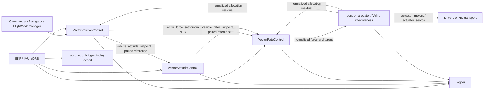
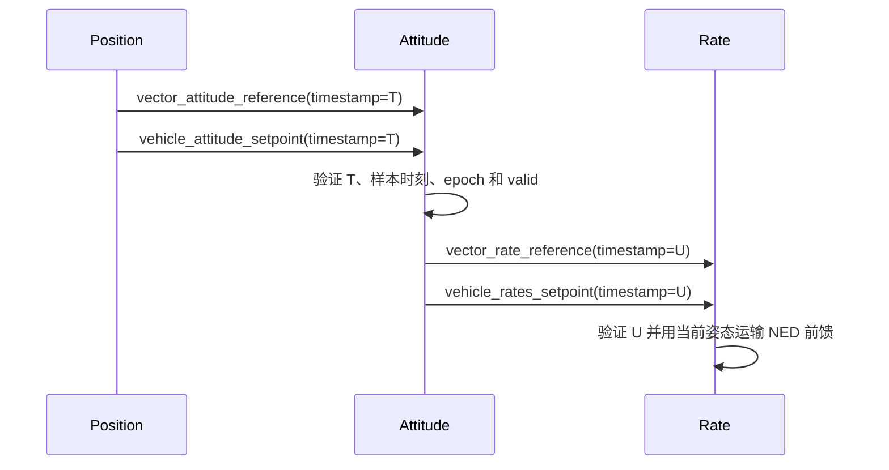

# Voliro T 飞控与仿真软件设计方案

版本：2026-11-03；与[算法设计方案](VoliroT_algorithm_design.md)配套。
范围：当前 PX4 工作区、JSBSim Voliro 模型及 UDP 派生姿态字段。本文整理实现，不新增控制代码。

## 1. 基线与交付状态

已提交的前一轮基础是 `c2b96701f7`。当前工作区另包含 ±160°、限位恢复及 UDP 显示修改，
不能只凭该 Git SHA 判断运行固件是否包含这些未提交内容。交付时应同时记录固件 SHA256、
模型文件 SHA256、参数快照和实际运行状态。

| 对象 | 当前状态 |
| --- | --- |
| PX4 vector 控制、分配、诊断 | 已实现；新模式默认关闭 |
| ±160° 参数、参考、公共倾转及模型映射 | 已实现并有本机测试记录 |
| UDP 原姿态字段的新约定 | 已实现，CA_AIRFRAME=17 自动选择 |
| 本机 JSBSim data 与 ROMFS 模型 | 执行器 XML 已同步修改 |
| 仿真板 voliro_t 执行器 XML | 2026-11-03 已部署到 192.168.3.82，重启后重新加载成功 |
| 配套 PX4 新固件与飞控参数 | 本次模型部署未烧写或修改，仍须核对实际版本与参数 |
| 实机/HIL 稳定性、真实接收 UI 验收 | 未完成 |

普通 MC 与 MorphQuad 保留各自控制路径。`geo_*` 的旧物理力矩接口不能与当前归一化 vector
控制链混用。一次只运行一套发布 wrench 的控制链。

## 2. 软件架构与职责



| 层 | 文件/目录 | 职责 |
| --- | --- | --- |
| 启动 | [rc.vector_apps](../ROMFS/px4fmu_common/init.d/rc.vector_apps) | 检查 MC 重复实例，启动 allocator、FMM、三个 vector 模块、原 multicopter land detector |
| 机架 | [19003_voliro_t](../ROMFS/px4fmu_common/init.d/airframes/19003_voliro_t) | CA_AIRFRAME=17、输出映射、几何示例、±160° 默认角度范围 |
| 任务 | [FlightTask.cpp](../src/modules/flight_mode_manager/tasks/FlightTask/FlightTask.cpp) | 新模式下用 force-plane heading 支持任务航向生成 |
| 位置包装 | [VectorPositionControl.cpp](../src/modules/vector_pos_control/VectorPositionControl.cpp) | 状态有效性、RC/模式门控、参考生命周期、消息发布 |
| 位置核心 | [VectorPosition.cpp](../src/modules/vector_pos_control/VectorPosition/VectorPosition.cpp) | 位置/速度反馈、NED 力、推力约束与积分抗饱和 |
| 参考 | [VectorAttitudeReference.hpp](../src/lib/vector_control/VectorAttitudeReference.hpp) | 受限参考、导数、力一致性与可用度调度 |
| 姿态 | [vector_att_control_main.cpp](../src/modules/vector_att_control/vector_att_control_main.cpp)、[VectorAttitude.cpp](../src/modules/vector_att_control/VectorAttitude/VectorAttitude.cpp) | 消息配对、四元数反馈、任务增益、机体角速度目标 |
| 角速度 | [VectorRateControl.cpp](../src/modules/vector_rate_control/VectorRateControl.cpp)、[角加速度核心](../src/lib/vector_control/VectorAngularAccelerationControl.hpp) | 前馈运输、加速度反馈、J 与归一化换算、诊断 |
| 分配包装 | [ActuatorEffectivenessVoliroT.cpp](../src/modules/control_allocator/VehicleActuatorEffectiveness/ActuatorEffectivenessVoliroT.cpp) | 参数、尾桨预演、最终输出重建与状态发布 |
| 分配核心 | [VoliroTAllocation.hpp](../src/modules/control_allocator/VehicleActuatorEffectiveness/VoliroTAllocation.hpp) | 正/逆向力矩模型、倾角/电机约束、限位优先与反扭矩滤波 |
| 尾桨 | [VoliroTTailMotor.hpp](../src/modules/control_allocator/VehicleActuatorEffectiveness/VoliroTTailMotor.hpp) | 命令域反转状态与计时 |
| 预测 | [VoliroTActuatorDynamics.hpp](../src/modules/control_allocator/VehicleActuatorEffectiveness/VoliroTActuatorDynamics.hpp) | 可选执行器估计，明确与测量分离 |
| UDP | [uorb_udp_bridge.cpp](../src/modules/uorb_udp_bridge/uorb_udp_bridge.cpp)、[AttitudeDisplay.hpp](../src/modules/uorb_udp_bridge/AttitudeDisplay.hpp) | 原字段导出、Voliro 角度解释、其他机型兼容 |

## 3. 标准 uORB 接口与单位契约

| 消息 | 生产者 → 消费者 | 关键语义 |
| --- | --- | --- |
| `trajectory_setpoint` | FlightModeManager/外部任务 → 位置包装 | 位置 m、速度 m/s、加速度 m/s²、航向 rad；沿用 NAN 控制语义 |
| `vehicle_attitude` | 估计器 → 各控制模块/UDP | q 为 w,x,y,z，FRD 到 NED；包括 quat_reset_counter |
| `vehicle_angular_velocity` | IMU 路径 → 角速度包装 | xyz 为机体 rad/s，xyz_derivative 为机体 rad/s² |
| `vector_force_setpoint` | 位置包装 → 角速度包装 | xyz 为 **NED 归一化力** |
| `vehicle_attitude_setpoint` | 位置/手动/Offboard → 姿态包装 | q_d 为四元数；thrust_body 为机体系归一化力 |
| `vehicle_rates_setpoint` | 姿态/Acro/Offboard → 角速度包装 | roll/pitch/yaw 为机体系 rad/s；不是三个姿态角 |
| `vehicle_thrust_setpoint` | 角速度包装 → allocator | xyz 为机体系归一化力 |
| `vehicle_torque_setpoint` | 角速度包装 → allocator | xyz 为机体系归一化力矩，不是 Nm |
| `control_allocator_status` | allocator → 控制环 | unallocated_thrust/torque 为对应归一化残差 |
| `actuator_motors / actuator_servos` | allocator → 驱动/HIL | 逐执行器归一化命令；M5 有符号、公共舵机按角度范围归一化 |

四元数与 force 转换在 core 和 wrapper 中各有职责，不能把 q_d 当作实际 R 来运输当前 NED 力。
同样，模型估计力矩不能写进标准归一化残差来冒充实际测量。

## 4. 私有参考、诊断与配对协议

| 消息定义 | 字段与作用 |
| --- | --- |
| [VectorAttitudeReference](../msg/VectorAttitudeReference.msg) | q_d、omega_ned、alpha_ned、原始/受限 NED 力、heading/bank/pitch、pitch_authority、epoch、valid |
| [VectorRateReference](../msg/VectorRateReference.msg) | 与标准 rates 目标配对的 NED 导数、来源 reference_timestamp、epoch、valid |
| [VectorRateControlStatus](../msg/VectorRateControlStatus.msg) | 机体 rate error、α前馈/反馈/积分、Nm 命令/交叉项/未分配量、前馈有效性 |
| [VectorActuatorStatus](../msg/VectorActuatorStatus.msg) | 最终命令模型与可选预测的推力/力矩、倾角、反扭矩滤波、armed/prediction_enabled |

参考中的 `pitch` 是**目标独立俯仰**，单位 rad；不是测得的实际独立 pitch。
实际值可从 vehicle_attitude.q 提取，或使用 UDP 实际姿态导出。
执行器 estimate 字段是预测，command 字段是最终命令反算；两者都不是传感器实测 wrench。

### 4.1 发布顺序



`reference_timestamp` 保存参考来源，方便追踪；速率目标精确配对使用该次 U，
不能拿来源 T 替代 U。私有消息先发布提高配对可用性，系统仍显式处理失配，不假定跨 topic 原子发布。

### 4.2 有效性门限

[referenceMatches](../src/lib/vector_control/VectorReferenceValidity.hpp)要求：

```text
reference.timestamp != 0
reference.timestamp == standard_setpoint.timestamp
reference.timestamp <= now
now-reference.timestamp < 100 ms
timestamp_sample != 0
 timestamp_sample <= reference.timestamp
now-timestamp_sample < 100 ms
reference.quat_reset_counter == current.quat_reset_counter
```

wrapper 另检查有效标志、有限向量、控制模式和所需实际姿态有效性。
角速度环使用的姿态还要求时间新鲜、四元数单位范数合理。

| 路径 | 当前新鲜度要求 |
| --- | --- |
| 前馈配对与样本 | <100 ms |
| 角速度环实际姿态 | <100 ms |
| 角速度抗饱和分配状态 | <100 ms |
| 位置环分配状态 | <200 ms |
| 角速度环的 NED force 目标 | <200 ms，且不早于本次位置控制激活时间 |
| 舵机预测参考调度 | <100 ms，armed 且 prediction_enabled |
| 独立俯仰 RC/手动输入 | <500 ms，并满足各自 valid/source/信号条件 |

不能将这些路径统一描述成一个超时常数。生产 loop 由消息和调度驱动；主机测试采用的
100/200/400 Hz 只是测试配置，日志的下采样频率也不等于实际执行频率。

## 5. 模式、门控与复位

### 5.1 模式选择

位置、姿态、角速度模块及 Voliro 分配对象在启动/构造时锁定新模式；
FlightTask 同样在构造时选择航向约定。修改 `VT_CTRL_MODE` 后必须整机重启，避免各模块/新建任务
使用不同模式。不允许以“参数显示已变成 1”代替运行模块确认。

| 逻辑状态 | 条件 | 动作 |
| --- | --- | --- |
| 旧模式 | VT_CTRL_MODE=0，或非对应机架 | 使用旧控制分支；UDP 的显示选择另按 CA_AIRFRAME 判定 |
| 新模式反馈可用 | CA=17、VT=1 已在启动生效 | 采用任务轴姿态反馈和角加速度/惯量角速度环 |
| 大俯仰参考允许 | 下述位置/RC/飞行门控 | 更新受限参考与配对前馈 |
| 私有参考无效/失配 | 时间、epoch、valid、数据检查失败 | 禁止前馈，继续标准目标反馈，保留可定义的任务轴增益 |
| 退出位置控制 | position-control flag 退出 | 清参考和参考力残差；外部机体 thrust 入口继续按原模式处理 |
| 落地/未解锁 | 对应状态有效 | 清角速度积分、复位尾桨/滤波/预测等生命周期状态 |

这是实现逻辑的归纳，不是新增了一套 Commander 飞行模式状态机。

独立 AUX1 俯仰要求：CA=17、VEC_AUX_ATT、位置核心更新成功、Position/Position Slow/Hold、
无 failsafe、已解锁、未落地且无 ground_contact；输入还要求新鲜有效的 RC 来源、已映射 AUX1、
有限 aux1 和有效的向量/回平开关。回平优先于使能。

RC 输入失效会移除独立俯仰需求；若模式门控仍允许，参考向零俯仰过渡。
若 failsafe 或任务状态也改变，则转入既有任务/故障路径，不能承诺所有情况下都继续相同大角度参考。
Mission/RTL/Offboard 等任务入口被复用，不等于这些模式都已开放 RC 独立大俯仰。

### 5.2 估计器与积分复位

- 参考由位置模块依据 attitude epoch 旋转，清除导数；本地位置复位处理调整输入轨迹，避免同一复位重复应用。
- 姿态核心可旋转已有 q_d；epoch 不一致时不沿用旧前馈。
- rates 目标的 reset_integral 同时复位旧积分和新角加速度积分。
- 新角加速度核心拒绝非有限输入和 `dt<=0` 或 `dt>20 ms`；参考核心拒绝 `dt<=0` 或 `dt>40 ms`。
- 原始测量坏数据、无效 frame 或参考被清除，不应被解释成“已经回平”。

### 5.3 尾桨保护生命周期

[尾桨核心](../src/modules/control_allocator/VehicleActuatorEffectiveness/VoliroTTailMotor.hpp)保存输出、
方向、候选反向、连续确认时间和零命令时间。预演复制该对象；真实状态仅在
`updateSetpointAfterSlew` 更新一次。每次清零状态必须同时处理低通与预测，避免重新解锁沿用旧状态。

| 设置 | 19003 示例值 | 含义 |
| --- | ---: | --- |
| CA_R5_SLEW | 0.4 s | 完整 −1 到 +1 扫幅时间 |
| CA_CT_T5_DZ | 0.03 | 停止死区 |
| CA_CT_T5_HYST | 0.10 | 启动/反转请求阈值 |
| CA_CT_T5_HOLD | 0.04 s | 持续反向请求确认 |
| CA_CT_T5_WAIT | 0.08 s | 连续零命令等待 |

这些是命令域保护参数，不是实测机械制停时间。

## 6. 参数设计与模型一致性

### 6.1 参数职责

| 参数 | 当前用途/初值 |
| --- | --- |
| CA_AIRFRAME=17 | Voliro 选择 |
| VT_CTRL_MODE | 0 默认旧模式；1 新模式，重启生效 |
| VEC_AUX_ATT / RC_MAP_AUX1 | 独立姿态开关与 RC 通道 |
| VT_PITCH_MAX | 上限/硬限幅 160°；通用默认 10°，19003 新默认 160° |
| CA_CT_ANGLE | 公共舵机归一化对应角度；当前新默认 160°，必须匹配模型 |
| VT_PITCH_RATE / VT_PITCH_ACC | 独立 pitch 速率/加速度，默认 20°/s、60°/s² |
| VT_BANK_RATE / VT_BANK_ACC | bank 参考上限 80°/s、360°/s² |
| VT_HEAD_RATE / VT_HEAD_ACC | heading 参考上限 45°/s、90°/s²；端点调度后可进一步减小 |
| VT_REF_FREQ | 参考模型频率 8 rad/s，非实测闭环带宽 |
| VT_BANK_P / VT_PITCH_P / VT_HEAD_P | 任务姿态增益 2/2/1，单位 1/s |
| VT_RATE_PX/PY/PZ | 8/12/8，单位 1/s |
| VT_RATE_IX/IY/IZ | 1/0.3/1，单位 1/s² |
| VT_RATE_DX/DY/DZ | 0.3/0.3/0.3，无量纲 |
| VT_RATE_ILIM / VT_RATE_AW | 2 rad/s²、2 1/s |
| VT_POS_AW / VT_REACT_FILT | 1 1/s、2 Hz；后者为反扭矩模态滤波 |
| VEC_IXX/IYY/IZZ | 实际机体系惯量，必须标定；通用默认不是当前模型匹配证明 |
| VEC_TQ_R/P/Y | Nm/归一化单位；19003 示例均为 10 |
| VPC_* | vector 位置/速度核心增益 |
| VC_* | 旧模式增益；新模式仍复用速率限制、Acro/手动等相关设置 |
| MPC_* | 共享任务限制、悬停推力、起降等；不替代 VPC 速度增益 |
| CA_CT_T5RMAX | 0 使用旧对称尾推力；正数为独立反推最大 N |
| VT_MOT_TAU / VT_SRV_TAU | 默认 0，关闭相应滞后预测 |

精确定义见[控制参数](../src/modules/control_allocator/voliro_control_params.c)、
[几何参数](../src/modules/vector_pos_control/vector_geometry_params.c)、
[分配参数](../src/modules/control_allocator/module.yaml)。已有保存值优先于 set-default，
扩大源码/元数据上限不会自动将旧参数 120 改成 160。

### 6.2 三组不能混用的模型值

| 来源 | Jx/Jy/Jz (kg m²) | 前 X / 尾力臂 (m) |
| --- | --- | --- |
| 当前本机原生测试 XML | 0.22/0.25/0.43 | 0.03/0.75 |
| 最新 MCAP 1793677711 运行时属性 | 约 0.18/0.12/0.43 | 0.09/0.69 |
| 19003 机架示例默认 | 通用 J 默认，未按该模型覆盖 | 0.14/0.64 |

MCAP 的 CG 结构坐标 X=0.06 m，前桨结构 X=-0.03 m、尾桨 X=0.75 m；
力臂必须相对 CG 计算。只改执行器 XML 的行程，不应顺带覆盖另一个模型的 CG/J。

最新 `12acc3c9-6671-44cf-8984-29d2353732c2` 日志记录 VT_CTRL_MODE=0、
VEC_IXX/IYY/IZZ=0.10/0.10/0.20、前/尾力臂=0.07/0.60 m，不能作为新模式已启用的证明。
旧模式 VEC_GYRO_FF=0 时，这组 J 并未参与新控制律的反馈换算；不能把 J 误配直接定为该次旧 PID 振荡的原因。

### 6.3 飞控与模型行程契约

以下两份文件已同步修改：

- `jsbsim_realtime/data/aviation/aircraft/voliro_t/VoliroTActuators.xml`
- `jsbsim_realtime/ROMFS/jsbsim/aircraft/voliro_t/VoliroTActuators.xml`

```text
servo_command = α_cmd / CA_CT_ANGLE
model_α_cmd = clamp(servo_command,-1,+1) * 2.792526803190927 rad
model_α_limit = +/-2.792526803190927 rad = +/-160 deg
```

飞控 CA_CT_ANGLE=120 而模型按160解释，会形成 4/3 的角度比例误差；反向不匹配则行程不足。
必须成对更新。主机测试库、板上固件及模型 FCS 初始化时的 dt 也必须记录，不能只从 XML lag 数字推断实际时间常数。

2026-11-03 已将仿真板 `/mnt/sdcard/jsbsim/aircraft/voliro_t/VoliroTActuators.xml`
从 ±120° 更新到 ±160°，并新增独立 pitch 显示属性。修改以板上原文件为基础，
保留原重心、惯量、推力曲线和命令映射；文件回读与上传内容一致。用户确认飞控未解锁并授权
重启后，已重新加载该 SD 模型；具体证据见第 9.4 节。飞控参数本次未修改。

## 7. 遥测、显示与兼容性

| 路径 | 定义与边界 |
| --- | --- |
| 原始 vehicle_attitude.q / 目标 q_d | 保持标准 FRD→NED 四元数语义 |
| 标准 MAVLink / QGC 姿态仪 | 保持标准欧拉/四元数处理，本次未修改 QGC |
| UDP CA=17 的 roll/pitch/yaw | 分别为 bank/独立 pitch/力平面 heading，仍为 rad |
| UDP vehicle_attitude_setpoint 同名字段 | 同样定义的目标值，便于直接比较 |
| UDP 其他机架 | 原标准 Euler 行为 |
| JSBSim independent-pitch-deg | 模型实际独立俯仰，不是舵机倾角 |

UDP 的选择只依赖 CA_AIRFRAME=17，不依赖 VT_CTRL_MODE；可用于诊断旧分支的大姿态。
原始四元数、body rate 与标准 uORB 未改。无效四元数输出 null，bank 坐标退化时未定义的
heading/pitch 输出 null。3D 接收端继续用四元数最直接；若用新标量角，应按 Rz-Rx-Ry 重构。

新四个 vector 诊断主题已经加入 logger，但尚未加入 UDP bridge 的通用 topic 注册表，
不能假定它们会自动通过 UDP 出现。具体导出说明见[bridge README](../src/modules/uorb_udp_bridge/README.md)。
UDP status 会显示当前使用的角度约定。日志/UDP 下采样后的曲线用于诊断，不作为实测力矩或完整高频时序证明。

## 8. 故障处理、影响与待解决项

| 场景 | 当前处理 | 验收关注 |
| --- | --- | --- |
| 前馈消息丢失、时间倒退、错配或 epoch 不同 | 关闭前馈，保留可定义的任务轴反馈 | 曲线中的 valid、feedforward_valid 与目标来源 |
| bank 接近坐标退化区域 | heading/pitch 参考或导出判无效，反馈按可用路径回退 | 不承诺任意翻滚下仍有该 heading 定义 |
| 舵机到机械止挡 | 可实现 My 优先、再拟合力；上报力残差 | 允许位置暂时退让，检查姿态是否先恢复 |
| 尾桨等待反转 | 预演当前可用推力并重配前桨；真实保护只推进一次 | 时序、零命令等待、实际制停能力 |
| 反扭矩饱和 | 约束同轴余量、保护每个前电机的数值边界 | 残差不能冒充实际力矩测量 |
| 已存参数仍为旧行程 | 不强制覆盖用户存储 | 对照参数快照与 XML 行程，不能只看源码默认 |
| 落地/故障检测在大姿态下误判 | 原系统逻辑继续生效，可能撤销大俯仰门控 | 必须验证 land/ground_contact/failsafe 时序 |
| Dock、紧急模式或电池缩放介入 | 既有包装层处理仍保留 | 不能将普通保持回归推广为所有特殊路径已验证 |

当前仍无倾角/RPM 闭环测量，没有基于实际 wrench 的完整可行性规划。
着陆检测未被替换为专用倒置逻辑；完整 Mission、RTL、失联回平与特殊模式仍需 HIL 验收。

## 9. 验证与验收

### 9.1 已有证据

| 验证组 | 工况/检查 | 证据层级 |
| --- | --- | --- |
| 控制核心回归 | 原 MC 等价、坐标变换、完整四元数、力/参考一致性 | 主机实际核心代码 |
| 参考协议 | 导数、限位制动、错时/陈旧/未来/epoch、积分复位 | 主机算法与协议函数 |
| 分配器 | 尾桨滞回/确认/等待、最终命令残差、止挡优先、反扭矩数值边界 | 主机分配核心及包装测试 |
| 多速率闭环 | 位置100/姿态200/角速度400 Hz，电机50–150 ms、J整体±20% | 解析六自由度与实际控制核心 |
| 原生 JSBSim | 当前本机 XML、FCS曲线、同轴偏置、±160保持/过渡/换向 | 进程内模型，不经过EKF/网络/任务包装 |
| 行程/显示 | data与ROMFS各自的输入钳位、±160舵机、跨90实际pitch属性 | 原生模型测试 |
| 启动 | 独立未解锁 MC、MorphQuad、Voliro旧/新模式启动 | POSIX启动检查，无传感器/驱动 |
| UDP | 全范围新显示、原机型回归、无效/奇异输入 | 转换函数 + 模块/固件编译，非板上抓包 |
| 构建 | px4_sitl_vector、cuav_7-nano_volirot | 软件构建 |

±160 原生 JSBSim 每项75秒，最后15秒统计：

| 工况 | 姿态误差峰值 | 最终姿态 RMS | 最终位置 RMS |
| --- | ---: | ---: | ---: |
| 0 → +160 → 0° | 0.91° | 0.011° | 0.001 m |
| 0 → −160 → 0° | 1.14° | 0.002° | 0.001 m |
| 0 → +160 → −160 → 0° | 3.71° | 0.028° | 0.008 m |

正常前馈工况判据：保持峰值<3°、过渡峰值<10°、最后15秒姿态RMS<1°、位置RMS<0.1 m、
最终bank峰值<0.5°。连续25秒无前馈工况允许20°航向指令的暂态误差<20°，稳态判据不变。
各项扰动并非所有大角度的完整笛卡尔组合，不能把已有覆盖描述成全部组合均通过。

记录位于 `build/voliro_pitch160_validation/manifest.json`、`closed_loop.log` 等，
UDP验证位于 `build/voliro_udp160_validation/manifest.json`。
这些是带日期和哈希的构建快照；后续改文档或重编译不应篡改旧记录来伪装重新验证。

### 9.2 可复现命令

```sh
CCACHE_DISABLE=1 make px4_sitl_vector
python3 src/modules/vector_pos_control/tests/run_tests.py build/px4_sitl_vector
python3 src/modules/control_allocator/VehicleActuatorEffectiveness/test_voliro_t.py build/px4_sitl_vector
python3 src/modules/uorb_udp_bridge/test_attitude_display.py build/px4_sitl_vector
python3 src/modules/vector_pos_control/tests/runtime_smoke.py build/px4_sitl_vector
CCACHE_DISABLE=1 make cuav_7-nano_volirot
```

原生 JSBSim 参数与行程测试命令见[实现记录](VoliroT_large_angle_control.md)。所有测试使用私有模型
副本移除网络 IO，不应占用正在使用的遥测端口或自动连接实体飞控。

### 9.3 板上 HIL 接受条件

1. 记录实际模型及执行器文件哈希、仿真板版本、飞控二进制哈希、参数快照和时间步。
2. 核对 J、相对CG的几何、推力正反曲线、旋向、反转能力、舵机角度比例和速率。
3. 未解锁状态下使所有模块以同一配置启动，三个 vector status 均确认新模式生效。
4. 在匹配模型的测试中逐步覆盖小角度、±60、±85、±90、±120、±140、±160以及回平/换向；
   检查物理四元数误差、bank、独立pitch和force-plane heading，不只看标准欧拉曲线。
5. 在各级动作中验证land/ground_contact/failsafe、控制频率、参考有效率、输出保护和分配残差。
6. 按独立测试计划验证航向指令、延时、传感器噪声/偏置和输入/模式变化。上述主机指标可作为初始
   对比目标，但不能直接替代板上安全与时延验收标准。

### 9.4 仿真板模型部署记录（2026-11-03）

- 设备：`192.168.3.82`；模型目录：`/mnt/sdcard/jsbsim/aircraft/voliro_t`。
- 修改文件：`VoliroTActuators.xml`；SHA256：`0d8ff4a326ad0d02270e4eaea7ce51446e15ae1cf4629fddcf6205f3928cd83b`。
- 同目录备份：`VoliroTActuators.before_pitch160.20261103T093907Z.bak`。
- 新启动日志：`/mnt/sdcard/LOG/2026-11-03/start_voliro_t_1793699107_00.log`。
- 日志确认读取该执行器 XML、`load-model-returned model=voliro_t ok=1`、`startup ready`。
- 板上模型私有副本的原生行程/显示测试通过；最终回读还确认主机架 XML 和命令映射未变化。
- 本次未烧写飞控、修改飞控参数或执行板上大角度闭环试验；加载成功不能替代 HIL 稳定性验收。

本机证据目录为 `build/voliro_board_update_20261103/`，包含备份、差异、回读、测试和启动日志，
以及 `deployment.json`。板端旧固件选择模型后仍需显式 START；本次已完成。

## 10. 维护与后续实施边界

当前文档对应“已实现、尚需系统验收”的版本。进一步接入实测执行器反馈、完整 wrench 可行性
调度、非对角惯量或大姿态专用着陆逻辑，均应建立单独需求、接口和回归记录。
新功能不应通过静默改动 MAVLink/uORB 标准单位或全局修改其他机架语义实现。

后续提交应按仓库和任务分开审查，保留其他实验改动；模型 data/ROMFS 的一致性和实际 SD
加载优先级应作为交付检查项。上述模型部署和重启已按用户授权执行；后续解锁、现场调参和
闭环试验仍按各自任务范围处理。
