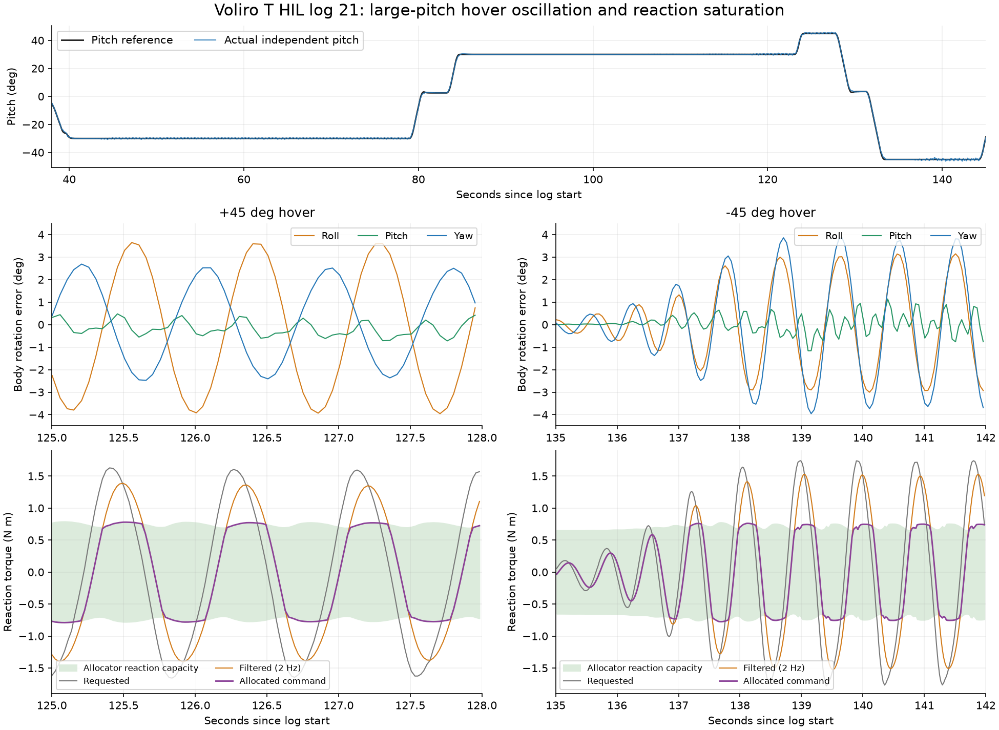

# Voliro T 大 pitch 悬停振荡：log21 诊断

输入：[Flight Review bbe896e4-09b0-4468-b37b-55a67d70e65c](http://localhost:5006/plot_app?log=bbe896e4-09b0-4468-b37b-55a67d70e65c)，本地文件为 `/home/qikai820/Documents/QGroundControl Daily/Logs/log_21_2026-11-13-10-29-22.ulg`。

CUAV 7 Nano，`SYS_HITL=3`，`SYS_AUTOSTART=19003`，日志约 147.1 s。以下时间均从 ULog 起点计算。这是板载 HIL 日志，不能作为实机飞行验证。记录的固件哈希为 `159117ad1bd37be5506160ad1868f135691e6420`；哈希不能唯一标识工作区内未提交的修改。

## 结论与证据强度

已确认：Vector 模式正常工作，大 pitch 时主要出现横滚/偏航耦合振荡，前部共轴电机的反扭矩分配周期性饱和。Pitch 本身的姿态误差小于主要横滚/偏航误差，但也出现较快的角速度纹波。

最需要验证的原因是反扭矩闭环的带宽与执行机构延迟不匹配。日志明确记录了反扭矩请求滤波的相位滞后；从角加速度重构的响应也存在进一步滞后。不过这是闭环数据，且缺少实际 RPM、舵机角和直接力矩测量，尚不能把全部滞后唯一归因到某个电机模型或确定一组修复 PID。

本轮新增诊断脚本、统计和图，不修改控制器、控制分配、默认参数或运行中的飞控参数。

## 模式与输入检查

- 35.343 s 明确记录 `Voliro: Vector mode selected`。
- 所分析的四个悬停窗口中，`vector_rate_control_status.feedforward_valid` 均为 100%；未出现倾转故障锁存、固定倾转回退或 Commander failsafe。
- 大角度窗口中尾桨推力指令均非负，不能把本次主振荡归因为尾电机正反转切换。
- `VT_PITCH_MAX` 在 123.078 s 由 30 改为 45 deg；该参数变化发生在进入 ±45 deg 段前。

## 定量结果

姿态误差使用 `q_actual^-1 * q_target` 的最短旋转向量，表达在当前机体系；下表不是欧拉角差。电机触底比例来自约 50 Hz 的分配状态采样，表示至少一个前部电机的推力指令接近零，不表示实际转速立即为零。

| 目标 pitch | 窗口 / s | 横滚/俯仰/偏航误差绝对峰值 / deg | 横滚/偏航角速度绝对峰值 / deg/s | 前部电机触底采样比例 |
| --- | --- | --- | --- | --- |
| −30 deg | 43–75 | 1.12 / 0.67 / 2.98 | 10.58 / 24.16 | 46.6% |
| +30 deg | 88–118 | 2.60 / 0.30 / 1.47 | 23.13 / 13.53 | 0.0% |
| +45 deg | 125–128 | 3.96 / 0.72 / 2.69 | 30.29 / 19.24 | 67.2% |
| −45 deg | 135–142 | 3.14 / 1.16 / 3.96 | 21.73 / 28.68 | 50.0% |

±30 deg 和 −45 deg 的反扭矩主频约 1.14–1.40 Hz。+45 deg 的选定窗口只有约三个周期，FFT 频率分辨率低，其峰值频点为 1.0 Hz，不能据此精确比较频率变化。

| 目标 pitch | 请求反扭矩绝对峰值 / N·m | 滤波后绝对峰值 / N·m | 分配后绝对峰值 / N·m | 可用反扭矩余量中位数 / N·m |
| --- | --- | --- | --- | --- |
| −30 deg | 1.270 | 1.070 | 0.747 | 0.709 |
| +30 deg | 0.851 | 0.676 | 0.676 | 0.650 |
| +45 deg | 1.657 | 1.400 | 0.791 | 0.748 |
| −45 deg | 1.779 | 1.526 | 0.776 | 0.702 |

这些力矩和余量都基于日志参数与分配器模型，不是实际测量的物理力矩。分配器已经在限制不可实现的请求；仅提高电机最大推力参数，不能证明在保持同样悬停升力时获得额外反扭矩余量。



## 为什么大 pitch 会表现为横滚和偏航一起摆动

Voliro 前部推力轴为 `g = [sin(tilt), 0, -cos(tilt)]`。分配器把请求力矩投影为：

```text
reaction_requested = sin(tilt) * torque_x - cos(tilt) * torque_z
```

接近水平时，这个通道主要控制机体偏航；pitch 增大后，它同时影响机体横滚和偏航。共轴差动反扭矩受同一组电机余量限制，因此本次振荡同时出现在这两个机体轴上。

`VT_REACT_FILT=2 Hz` 的一阶滤波确实处于该闭环中。所选窗口主频处，请求到滤波输出的相位滞后约 28–34 deg。由日志惯量 `J` 和陀螺数据构造 `J * angular_acceleration + omega × (J * omega)` 后，相对于分配后指令还可见约 45–63 deg 的滞后。后者含执行机构、采样、传感器滤波及模型误差影响，是支持延迟问题的线索，不能当作独立测得的电机传递函数或直接计算开环相位裕度。

## 对修改方向的约束

1. **优先验证反扭矩通道的动态，再决定增益。** 在当前加载的 HIL 模型上，核对前电机命令到 RPM/推力/反扭矩的映射、延迟与惯量。仓库里的模型文件不证明板上当前已加载相同版本。
2. **把反扭矩轴与较强的差动升力轴分别处理。** 如需代码调度，应限制到 `CA_AIRFRAME=17 && VT_CTRL_MODE=1`，围绕实际倾转轴、可用余量和执行机构带宽设计。直接把所有机体系 roll/yaw 增益一起缩小，会同时改变两个物理通道，无法仅凭本日志选出正确比例。
3. **保留原分配器的余量限制和最终指令抗积分饱和。** `ActuatorEffectivenessVoliroT::updateSetpointAfterSlew()` 已把最终指令残差提供给速率环；本次看到的削顶并非遗漏这一反馈的证据。
4. **不能仅靠降低 `VT_ATT_SCALE` 处理 ±30/45 deg。** 当前 `referenceFeedbackScale()` 在 45 deg 以内保持 1，45–75 deg 才过渡到该比例。日志中的 `VT_ATT_SCALE≈0.333` 对这些中等 pitch 角并未提供预期的带宽降低。
5. **`VT_MOT_TAU` / `VT_SRV_TAU` 是可选预测参数。** 当前都为 0；它们不是控制器的延迟补偿开关，填入时间常数不会自动消除本次振荡。

使用实际分配器和 PID 的简化刚体敏感性试算也表明，结果随假定的电机延迟变化，单独提高反扭矩截止频率或降低外环 heading 增益均不能覆盖所有情况。因此本轮不发布一组未经当前 HIL 模型验证的新参数。

验证顺序应覆盖固定目标 pitch 的 0、±15、±30、±45 deg，分别施加小横滚/航向扰动，并记录实际 RPM、舵机角、角速度、反扭矩请求、分配后指令与余量。验收应要求扰动衰减、退出周期性电机触底，并保持升力与 pitch 跟踪。随后再覆盖连续 pitch 变化、Normal/Vector 切换，以及原三旋翼和 MorphQuad 回归；静态分配测试或编译通过不能代替这些动态验证。

## 复现诊断

```sh
python3 docs/analysis/voliro_log21_20261113/analyze.py \
  '/home/qikai820/Documents/QGroundControl Daily/Logs/log_21_2026-11-13-10-29-22.ulg'
```

依赖 `pyulog`、`numpy`、`matplotlib`；输出为同目录的 `summary.json` 和 `evidence.png`。脚本只读取日志、写入诊断文件，不连接运行中的飞控或仿真器。
