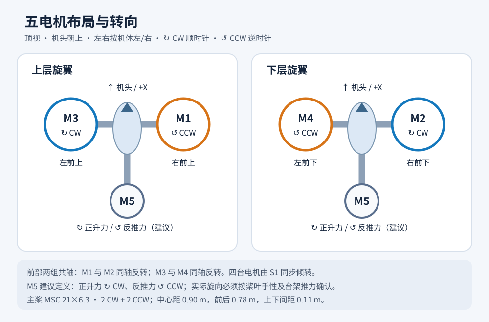
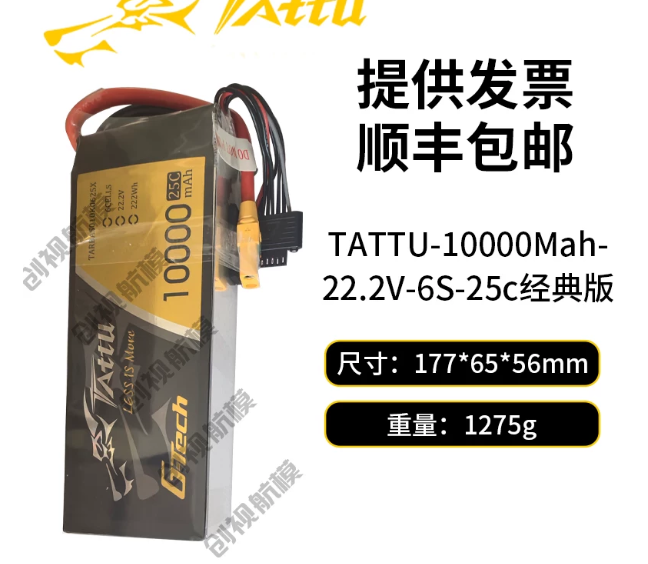
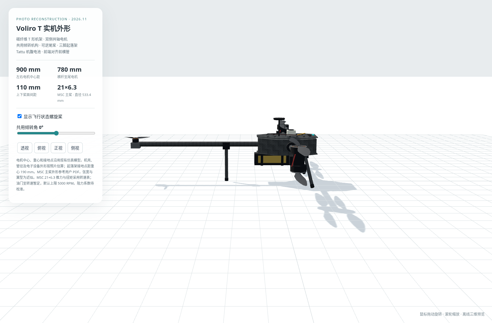
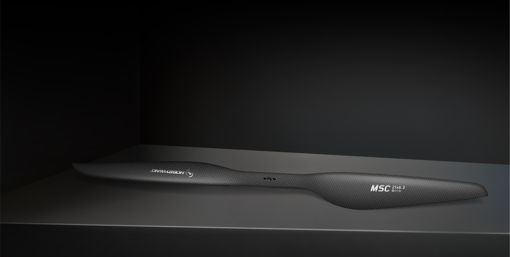
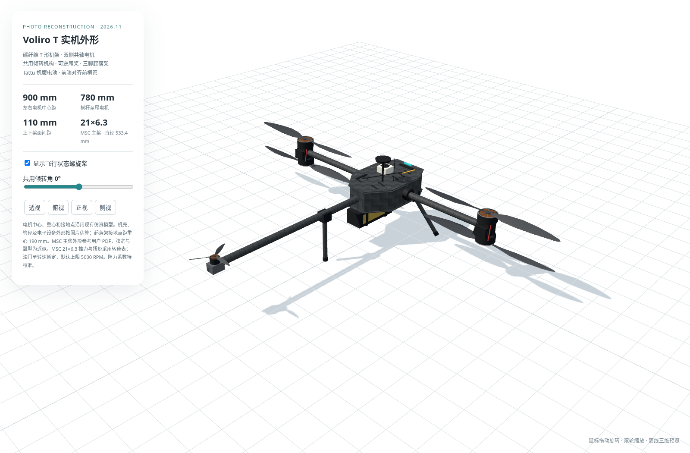

# Voliro T 衍生五电机平台硬件方案设计

> 更新：2026-11-12。适用对象为本仓库 `19003_voliro_t` 及配套 `voliro_t` 模型：前部两组共轴旋翼、一个共用倾转舵机、一个可反转尾电机。外形参考用户实机照片，主尺寸沿用现有模型。主桨资料为 **HOBBYWING MSC 21×6.3**；电池新增 **Tattu 10000 mAh / 22.2 V / 6S / 25C 经典版**商品图规格。厂家规格、商品图标称值、视景几何和推进模型状态分别记录。

## 1. 总体构型与几何基准

机体采用 T 形碳管机架、中央碳纤维机壳和三脚起落架。左右两端各安装一组上下共轴、反向旋转的主电机；长尾杆末端安装固定轴向、可反转尾电机。S1 同步倾转前部四台电机。实机照片中的前部大桨尚未安装；完整视景补齐四支两叶主桨和一支三叶尾桨。

| 项目 | 当前采用值 | 数据性质 |
| --- | --- | --- |
| 左右共轴组中心距 | 900 mm | 沿用模型/既有尺寸记录 |
| 前电机连线至尾电机中心 | 780 mm | 沿用模型/既有尺寸记录 |
| 共轴上下桨面间距 | 110 mm | 既有用户尺寸记录；仿真为 ±55 mm |
| 仿真质量 | 4.70 kg | 当前模型值；本次不叠加桨叶重量 |
| 仿真惯量 Ixx / Iyy / Izz | 0.28 / 0.16 / 0.38 kg·m² | 模型估计值；交叉项为 0 |
| JSBSim 结构坐标系重心 | (0.04, 0, 0) m | 当前模型值 |
| 机壳长 × 宽 × 高 | 300 × 200 × 80 mm | 照片比例估算，不是实测 CAD 尺寸 |
| 横管 / 尾管外径与壁厚 | 均为 25 mm，壁厚 1 mm | 原 Word 文档中的用户确认；视景及阻力已统一 |
| 前电机外壳直径 / 高度 | 68.7 / 25.8 mm | 原 Word 中 M6208 厂家参考尺寸；安装接口另核对 |
| 起落架接地点距重心高度 | **190 mm（19 cm）** | 2026-11-12 用户指定；三个接地点横向/纵向坐标及上端固定点保留 |

### 1.1 坐标、编号与旋向

采用机体系 FRD：X 向前、Y 向右、Z 向下。示意图为从上往下看、机头朝上。旋向指电机轴/桨叶转动，机体承受的反扭矩相反。PX4 坐标来自当前机架脚本，JSBSim 坐标以仿真重心为原点，两套数值尚未统一。

| 编号 | 位置 | PX4 脚本分配器坐标（m） | JSBSim 重心相对坐标（m） | 正升力旋向（顶视） | 物理 / HIL 输出 |
| --- | --- | --- | --- | --- | --- |
| M1 | 右上 | (+0.14, +0.45, 0) | (+0.07, +0.45, -0.055) | CCW | MAIN1 / 0 |
| M2 | 右下 | (+0.14, +0.45, 0) | (+0.07, +0.45, +0.055) | CW | MAIN2 / 1 |
| M3 | 左上 | (+0.14, -0.45, 0) | (+0.07, -0.45, -0.055) | CW | MAIN3 / 2 |
| M4 | 左下 | (+0.14, -0.45, 0) | (+0.07, -0.45, +0.055) | CCW | MAIN4 / 3 |
| M5 | 尾部 | (-0.64, 0, 0) | (-0.71, 0, 0) | 建议 CW 正升力、CCW 反推力，待核对 | MAIN5 / 4 |
| S1 | 共用倾转轴 | 同步驱动 M1–M4 | 同步驱动 M1–M4 | 不适用 | MAIN7 / 5 |

原 Word 中实机重心记录为前连线后 0.03 m，对应实机设计力臂 0.03 / 0.75 m。PX4 脚本默认仍为 0.14 / 0.64 m；当前仿真为 0.07 / 0.71 m。本次修订不改变实机重心，也不改写飞控参数。M1–M4 沿推力轴的反扭矩符号为 `-,+,+,-`。M5 应按实际桨叶手性、安装面和 ESC 设置确定正命令的升力方向。

## 2. 动力、电气与机构选型

| 部件 | 数量 | 当前方案 / 配置 | 依据与限制 |
| --- | --- | --- | --- |
| 前主电机 | 4 | Hobbywing M6208 KV310 | 既有装机配置 |
| 前主桨 | 4 支整桨 | **MSC 21×6.3，两叶碳纤维直桨，2 CW + 2 CCW** | 本次 PDF 和图片；M6208 装配与装机性能待核对 |
| 前 ESC | 4 | Hobbywing XRotor Pro H60A 14S BLDC，6–14S 系列 | 既有配置；不能仅凭“60A”名称认定持续工作电流 |
| 尾电机 | 1 | BSC2412 KV1900 | 既有配置 |
| 尾桨 | 1 支整桨 | 三叶 6045，直径 152.4 mm，名义螺距 114.3 mm | 沿用既有配置；本次附件不涉及尾桨 |
| 尾 ESC | 1 | **Flycolor RAPTOR5 猛禽5 45A**，双向/3D 设置 | 原 Word 用户规格图确认；45 A 持续、55 A 10 s、10.2 g、33 × 16 × 6 mm；换向响应待测 |
| 电源 | 单块，沿用原 Word 装配记录 | **Tattu 10000 mAh / 22.2 V / 6S / 25C 经典版** | 用户提供的商品图；单块 1275 g、177 × 65 × 56 mm，详见下节 |
| 倾转舵机 | 1 | S1 同步驱动四台前电机 | 本次资料未给出型号、额定扭矩与实际机械限位 |
| 飞控 | 1 | CUAV 7 Nano | MAIN1–5 为电机，MAIN7 为舵机 |

前 ESC 既有模型按 PWM 1100–1940 μs 解释厂商油门，历史飞控输出端点为 1000–2000 μs，两者需要转换。该配置来自先前装机确认，本次桨叶 PDF 未给出 ESC、供电电压或油门映射。MAIN5/6 共用定时器，M5 使用 DShot 时 S1 接 MAIN7，不能在 MAIN6 混用 PWM。

当前脚本默认倾转角上限为 ±160°、速率为 200°/s；JSBSim 舵机速率为 3 rad/s（约 171.9°/s）。软件设置不等于已确认的机械可达范围。

### 2.1 电池规格与质量记账

以下标称值来自用户提供的商品图片，尚未用厂家规格书或实物称量复核。图片中的发票、包邮等销售文字不属于硬件参数。

| 项目 | 数值 | 依据 / 含义 |
| --- | --- | --- |
| 品牌与版本 | Tattu 经典版 | 商品图标注 |
| 容量 | **10000 mAh = 10 Ah** | 单块标称容量 |
| 标称电压 | **22.2 V** | 商品图标注；不是恒定工作电压 |
| 串数 | **6S** | 单块电池内部串数，不代表整机使用几块电池 |
| 放电倍率 | **25C** | 商品图标称值；未给出持续/峰值测试条件 |
| 外形尺寸 | **177 × 65 × 56 mm** | 按图片顺序记录；线束、接头和安装余量另行核对 |
| 单块重量 | **1275 g = 1.275 kg** | 商品图标称，待实物称量 |
| 标称能量 | **222 Wh** | 计算值：22.2 V × 10 Ah；不是已测可用能量 |
| 倍率对应电流 | **250 A** | 仅按 25C × 10 Ah 换算；不是装机实测持续电流，也不代表线束、接头或配电板额定值 |
| 装机块数 / 供电分路 | 单块方案；供电分路另核对 | 单块来自原 Word 的用户记录；新图片未重新确认接线 |
| 视景安装 | 机身下方，177 mm 长边沿前后方向、横向居中 | 本次用户指定下挂安装 |
| 前后对齐 | 电池前端与前横碳管中心线对齐；中心在横管后 88.5 mm | 替代旧位置记录中的 80 mm；原电机布局图保留 |
| 视景位置与间隙 | 相对现有仿真 CG 的 FRD 中心为 (-18.5, 0, +75) mm；顶面距机壳底板 4 mm | 垂向间隙为建模假设，未实测安装件 |
| 接头型号、内阻、压降和可用容量 | 待确认 / 待测 | 本图未提供可核实参数 |

质量表按每块 **1.275 kg** 记账，单块方案沿用原 Word 装配定义；若装配块数变化，按 `1.275n kg` 重新核算。现有 **4.70 kg** 是整机仿真总质量，本次仅补充电池资料，不在该数值上直接加上 1.275 kg，也不根据未知的电池块数改写重心和惯量。旧模型注释中的“两块 0.67 kg 电池”不能作为本次电池的质量依据。

标称 22.2 V 与历史推进台架的 23 V 是不同性质的数据。仿真供电若需反映这款电池，应在确认电池块数、接线方式及负载电压后再建立电压/内阻/容量模型；本次商品图更新不改变飞控电池参数或仿真供电常数。结构化记录见 [电池规格 JSON](../assets/voliro_t/tattu_10000mah_6s_25c_specification.json)。

此次下挂位置用于视景装配；电池随机身运动，不随前部共轴电机倾转。整机质量、重心、惯量和现有 30 点阻力模型保持既有值，未将电池质量重复叠加。

## 3. MSC 21×6.3 桨叶规格与安装

依据：[用户提供的厂家 PDF，第 1 页](../d205fbfd312fd4a82335a9635710b2fb.pdf)。图片与 PDF 均标注 MSC 21×6.3，取代本方案前主桨的旧 22×7.8 选型记录。

| 项目 | 厂家资料值 / 换算值 |
| --- | --- |
| 型号 | MSC 21×6.3 |
| 直径 | 21 in = **533.4 mm** |
| 名义螺距 | 6.3 in = **160.02 mm**；不等于全桨统一安装角 |
| 叶片数与形式 | 两叶一体直桨，非折叠桨 |
| 单支整桨重量 | **47 g**；四支整桨合计 **188 g**，不是每片叶片 47 g |
| 主要材质 / 表面工艺 | 碳纤维 + 环氧树脂 / 哑光磨砂 |
| 厂家最佳转速范围 | **3000–5000 RPM** |
| 厂家常用拉力范围 | **2.5–4.5 kgf**，约 24.52–44.13 N |
| 厂家极限拉力 | **11.0 kgf**，约 107.87 N；不作为本机持续额定推力 |
| 厂家推荐电机 | **M5208 / M6215**；未将 M6208 KV310 列为推荐组合 |
| 存储温度 / 使用环境温度 | -10～35 ℃ / -40～65 ℃ |
| 存储湿度 | ≤85% |
| 中心孔 | Ø6 mm，图示公差 +0.10 / 0 mm |
| 两安装孔 | 2 × Ø3 mm，图示公差 +0.20 / 0 mm |
| 其他安装几何标注 | 原图标注 Ø12 mm；具体装配位置依原图复核 |
| 中心厚度 | **4.8 ± 0.2 mm** |

选用 2 CW + 2 CCW 整桨，与 M1/M4 的 CCW、M2/M3 的 CW 对应。上下共轴安装还须检查正反面与推力方向，不能只按转向或包装上的手性字样判断。孔位和厚度用于接口核对；视景轮廓、后掠与翼型按图近似，不用于加工。

当前 110 mm 间距对应 `h/D = 110/533.4 ≈ 0.2062`；旧 22 in 共轴表为 `D=558.8 mm`、`h/D≈0.1969`。修改视景桨径不等于更新共轴气动模型。47 g 也不直接叠加到既有 4.70 kg 总质量，转动惯量须另测或按真实质量分布识别。

### 3.1 厂家转速、拉力、扭矩数据

以下 17 组来自 PDF 第 2 页，保留原表数值。原表“拉力(g)”按 gf（克力）解释，`1 gf = 0.00980665 N`。[完整 CSV](../assets/voliro_t/msc_21x6p3_performance.csv) 含 SI 换算和范围标记；[规格 JSON](../assets/voliro_t/msc_21x6p3_specification.json) 含来源页码、PDF SHA-256 和限制。

| 序号 | 拉力（gf） | 拉力（N） | 转速（RPM） | 力效（gf/W） | 扭矩（N·m） |
| --- | --- | --- | --- | --- | --- |
| 1 | 1800 | 17.652 | 3320 | 12.7 | 0.4 |
| 2 | 2400 | 23.536 | 3840 | 10.9 | 0.5 |
| 3 | 3000 | 29.420 | 4290 | 9.8 | 0.7 |
| 4 | 3600 | 35.304 | 4690 | 8.9 | 0.8 |
| 5 | 4200 | 41.188 | 5050 | 8.3 | 1.0 |
| 6 | 5000 | 49.033 | 5500 | 7.6 | 1.1 |
| 7 | 5600 | 54.917 | 5810 | 7.2 | 1.3 |
| 8 | 6200 | 60.801 | 6110 | 6.8 | 1.4 |
| 9 | 6800 | 66.685 | 6400 | 6.5 | 1.6 |
| 10 | 7400 | 72.569 | 6660 | 6.2 | 1.7 |
| 11 | 8000 | 78.453 | 6910 | 6.0 | 1.9 |
| 12 | 8600 | 84.337 | 7130 | 5.8 | 2.0 |
| 13 | 9200 | 90.221 | 7340 | 5.6 | 2.1 |
| 14 | 9800 | 96.105 | 7530 | 5.4 | 2.3 |
| 15 | 10400 | 101.989 | 7710 | 5.3 | 2.4 |
| 16 | 11100 | 108.854 | 7940 | 5.2 | 2.6 |
| 17 | 11700 | 114.738 | 8180 | 5.0 | 2.7 |

**范围说明：**第 5–17 点超过推荐转速 5000 RPM，最后两点还超过另列的 11.0 kgf 极限拉力。本表保留它们用于追溯，不将其定义为本机可用工作点。两页未给出测试电机、电压、空气密度、ESC 油门或共轴条件，因此不能独立确定本机油门、输入电流或装机最大推力。

## 4. 视景、推进与气动阻力

### 4.1 带桨三维视景

前部主桨按 533.4 mm 桨径补入随半径变化的弦宽、后掠、名义螺距扭转、4.8 mm 根部厚度和 6 mm 中心孔，并按旋向镜像。尾部保留 6045 三叶桨。预览默认显示五支整桨，可切换无桨模式；实时视景保留独立 RPM、共用倾转、暂停与数据过期处理。

几何用于装配外形和运动展示，弦宽、叶型、后掠与厚度分布未通过三维测量或 CFD 标定。名义螺距不等于已知完整翼型。

### 4.2 推进基线与换桨标定

| 项目 | 当前状态 |
| --- | --- |
| 本次硬件方案 / 推进及视景主桨 | **MSC 21×6.3**，按本次附件更新 |
| 前电机推进曲线 | **实际 RPM → MSC 21×6.3 的 17 点推力及稳态扭矩表**；低于 3320 RPM 二次外推至零 |
| 共轴损失 | 按 533.4 mm 桨径与 110 mm 间距重新生成 **26×26 单桨推力输入耦合表**；仍为工程估算 |
| 前电机 RPM 与加速反作用 | 沿用既有 RPM 状态及条件辨识模型，不由新桨重量直接替换 |
| M5 | 原生可逆 BLDC + 三叶 6045 桨模型，参数为工程先验 |
| 油门到 RPM | H60 PWM 端点与旧 23 V 转速目标参考保留，明确标为暂定；默认限到 **5000 RPM** |
| 新桨推力倍率 | **1.0**；旧 22×7.8 悬停倍率 1.007239 不再作用 |
| 质量、惯量、重心、飞控参数 | 本次保持现值；接地点高度已单独改为 190 mm |

**推进的 F(RPM)、Q(RPM) 已更新为 MSC 21×6.3 数据；油门到 RPM 尚未完成装机标定。** 5000 RPM 时单桨约 40.3707 N、0.972222 N·m。后续应补测匹配套装的 PWM/RPM 响应与共轴损失；保留的前转子加速反作用候选也需重新核对。旧文档“默认固定 0.80 效率、每台最大 54.74 N”已不适用于当前默认模型，也不能移用给新桨。

### 4.3 机体空气阻力

`VoliroTBodyDrag.xml` 在机壳、碳管、电机、起落架和电子设备上设置 30 个分布点，以 `v_local = v_air + ω_air × r` 计算方向性 `F = -0.5 ρ CdA |v_local| v_local`，并累加 `r × F` 产生转动阻尼。主电机的位置和阻力轴随共同倾转角变化。

零倾转总方向性 CdA 约为 **0.06011 / 0.06493 / 0.11785 m²**（机体 X/Y/Z），属于工程估算。该模型不把旋翼当实心圆盘，也未补齐拍振、旋翼尾流或地效；增加桨叶视景不自动补齐这些效应。

原生 JSBSim 已验证 600 组速度、角速度和倾转组合耗能，并检查静止受风、反向速度、二次速度关系和关闭阻力。完整无动力仿真水平速度由 5.00 m/s 在 1 秒内降至约 4.86 m/s。这些是软件检查，不代表闭环 HIL 或实飞稳定性验证。

### 4.4 起落架高度与初始离地高度

三个接地点统一位于仿真 CG 下方 190 mm，FRD 坐标为 `(0.17,-0.18,0.19)`、`(0.17,0.18,0.19)`、`(-0.25,0,0.19)` m。JSBSim 结构坐标的接触点 Z 同步改为 -0.19 m。模型 `initfile.xml`、`reset.xml` 和板端配置初始高度同步到约 0.19 m AGL，避免仍从 0.50 m 释放。

电池最低点在 CG 下方约 103 mm，水平未压缩时几何离地间隙约 87 mm。脚架缩短后只重算相关阻力站；质量、惯量、重心、弹簧/阻尼和摩擦系数保持原值。现有场景 0.50 m 障碍球保留；在当前接地求解器下，平面支撑由脚架承担。原生测试通过无场景/现有 2592 三角形场景的受风静置、落地与离地，以及墙面、倒置和收起脚架保护。

## 5. 控制分配与静态平衡

四台主电机共用倾转角 `α`，推力方向为 `(sin α, 0, -cos α)`。M5 沿机体 Z 轴工作，正命令向上升力，负命令向下推力。左右组差动产生横滚，前后推力差产生俯仰，共轴反扭矩差参与偏航。本构型不能在机体不横滚时独立产生侧向推力。

当前 PX4 脚本为 `CA_AIRFRAME=17`、`CA_CT_X=0.14`、`CA_CT_Y=0.45`、`CA_CT_TAIL=0.64`、`CA_CT_TMAX=39.5 N`、`CA_CT_T5MAX=10 N`、`CA_CT_KM=0.02 m`、`CA_R_REV=16`。脚本默认值不等于飞控已保存参数或新桨装机标定。

水平悬停且俯仰力矩为零时，前/尾力臂为 `a/b`，`T5 = mg·a/(a+b)`，每台前电机平均推力为 `(mg-T5)/4`。用 **4.70 kg**、`g=9.80665 m/s²` 核算：

| 几何基准 | 总升力（N） | M5 推力（N） | 每台前电机平均推力（N） |
| --- | --- | --- | --- |
| 实机设计记录 a/b = 0.03/0.75 m | 46.091 | **1.773** | **11.080** |
| JSBSim 当前 a/b = 0.07/0.71 m | 46.091 | **4.136** | **10.489** |
| PX4 脚本默认 a/b = 0.14/0.64 m | 46.091 | **8.273** | **9.455** |

应统一真实重心和力臂后再解释尾电机余量。静态平衡不等于已知油门，也不代表每组上下桨实际推力相等。旧文档混用 5.0/5.04 kg 和不同几何的核算由本表替代。

## 6. 尾电机保护与验证事项

M5 默认保护参数为 `CA_R5_SLEW=0.4 s`、`CA_CT_T5_DZ=0.03`、`CA_CT_T5_HYST=0.10`、`CA_CT_T5_HOLD=0.04 s`、`CA_CT_T5_WAIT=0.08 s`。反向请求先使输出限速降到零，满足持续反向请求及完整过零等待后再启动。等待不代表检测到真实停转；本次主桨资料不改变这些参数。详见 [尾电机保护说明](../VoliroTTailProtection.md)。

验证顺序沿用拆桨核线序、单桨夹具测试、装机共轴与尾桨双向标定、无桨 HIL/机架约束试验和受限闭环验证。新增主桨需核对安装面、孔位/紧固、CW/CCW 推力方向，并补测 PWM/RPM/推力/扭矩、共轴损失及转动惯量。文件部署与实例重载分别记录；不因更新文档或上传视景就认定推进参数已经生效。

## 依据与资料位置

- [厂家 PDF](../d205fbfd312fd4a82335a9635710b2fb.pdf)：第 1 页规格/尺寸，第 2 页 17 组性能数据；本次用户提供。
- [主桨产品图](../assets/voliro_t/msc_21x6p3_propeller.png)、[电机配桨示意图](../assets/voliro_t/msc_21x6p3_motor_propeller.png)：本次用户提供，图片不证明装机适配或性能。
- [数据 CSV](../assets/voliro_t/msc_21x6p3_performance.csv)、[规格 JSON](../assets/voliro_t/msc_21x6p3_specification.json)：原表、SI 换算、范围标记和来源校验值。
- [Tattu 电池商品图](../assets/voliro_t/tattu_10000mah_6s_25c_reference.png)、[电池规格 JSON](../assets/voliro_t/tattu_10000mah_6s_25c_specification.json)：用户提供的图片标称值及计算值，非实测结果。
- [19003_voliro_t](../../ROMFS/px4fmu_common/init.d/airframes/19003_voliro_t)、[VoliroTAllocation.hpp](../../src/modules/control_allocator/VehicleActuatorEffectiveness/VoliroTAllocation.hpp)。
- 原 Word 装机记录：`VoliroT_硬件与动力学设计说明_20261110_H60_PWM修订.docx`；其中单块电池、25 mm/1 mm 碳管、RAPTOR5 尾电调与实机几何记录优先于早期暂定值。
- 仿真源：`jsbsim_realtime/data/aviation/aircraft/voliro_t/`；板端外部模型：`/mnt/home/jsbsim/aircraft/voliro_t/`。主 XML、`VoliroTCoaxial.xml`、`TailPropulsion.xml`、`VoliroTBodyDrag.xml` 和 `data/airframe_geometry_20261111.json` 分别记录对应参数。
- 视景源：`jsbsim-visual-editor/client/src/sim/sceneVoliroT.ts`、`scenePropeller.ts`、`voliroTGeometry.json`；GLB、元数据及离线预览位于 `client/public/aircraft/voliro_t/`。

以上针对本工程衍生构型，不将商业 Voliro 产品的独立倾转自由度或性能视为本机已实现能力。
