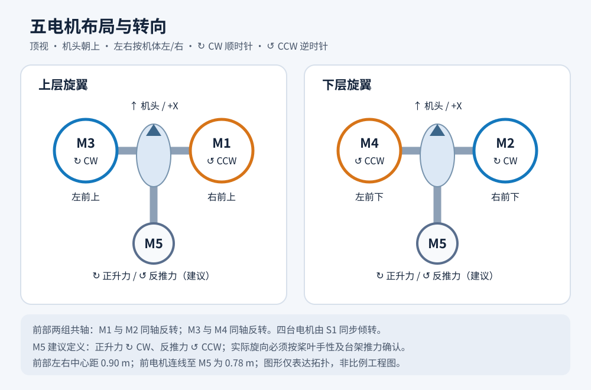

# Voliro T 衍生五电机平台设计方案

> 适用对象：本仓库 `19003_voliro_t` 机架及配套 JSBSim 五电机模型。它是前部两组共轴、一个共用倾转舵机、一个可反转尾电机的工程方案。Voliro 官方产品采用可倾转旋翼实现全向运动；下述结构与控制自由度以本工程的实际配置为准。

## 1. 坐标、布局与旋向

采用机体系 FRD：X 向前、Y 向右、Z 向下。图为**从上往下看、机头朝上**；↻ 表示顺时针（CW），↺ 表示逆时针（CCW）。旋向指**电机轴/桨叶转动**，不是机体受到的反扭矩。上下共轴电机同轴反转。

| 编号 | 安装位置 | FRD 坐标（m） | 悬停正升力时旋向 | PX4 主输出 | HIL 输出 |
| --- | --- | --- | --- | --- | --- |
| M1 | 右前上层 | (+0.14, +0.45, −0.03) | **↺ CCW** | MAIN1 | 0 |
| M2 | 右前下层 | (+0.14, +0.45, +0.03) | **↻ CW** | MAIN2 | 1 |
| M3 | 左前上层 | (+0.14, −0.45, −0.03) | **↻ CW** | MAIN3 | 2 |
| M4 | 左前下层 | (+0.14, −0.45, +0.03) | **↺ CCW** | MAIN4 | 3 |
| M5 | 机尾 | (−0.64, 0, 0) | **建议 ↻ CW 正升力；↺ CCW 反推力**¹ | MAIN5 | 4 |
| S1 | 前部共用倾转轴 | 驱动 M1–M4 | 不适用 | MAIN7 | 5 |

¹ M5 的转向是**建议的装配定义**，不是从现有模型或电机型号得到的实测结论。应以实际 6045 桨叶手性和安装面为准：若 CW 产生向下推力，就将 M5 的正升力定义改为 CCW，同时检查 ESC 正反向设置。正反转跨零时的推力、死区和延迟也需测量。

两组前电机中心横向相距 0.90 m；前电机连线至 M5 为 0.78 m；重心位于前电机连线后方 0.14 m（2026-10-30 实测修正）。上/下层的 ±0.03 m 仅是 JSBSim 暂定间距，PX4 分配器目前把两层视为相同的 Z 坐标。M1/M2 和 M3/M4 的反扭矩方向分别相反；分配器采用沿推力轴的 `-,+,+,-` 反扭矩系数。按从上往下看的右手法则，上表的 CW/CCW 与这些符号对应。M5 的反扭矩尚未计入分配器，需要通过台架和飞行日志评估其影响。

## 2. 动力、电气与机构

- 前部 M1–M4：现有配置为 Hobbywing 6208 KV310、22×7.8 桨、Hobbywing 60 A ESC、6S 电源。每组共轴桨须配一副适合相反旋向的桨叶，且分别核对电机上/下安装朝向。
- 尾部 M5：现有配置为 BSC2412 KV1900、三叶 6045 桨、Flycolor 45 A BL-32 ESC、6S 电源。选用允许双向命令的 ESC 配置；确认所装桨在正反转时的真实推力方向和可用推力。
- S1：单个倾转舵机通过刚性传动同步驱动四个前电机，要求零位一致、无明显回差，并设置机械限位。软件默认角度上限 ±120°、速率上限 90°/s；这些是参数值，不代表机构已验证达到该范围。
- CUAV 7 Nano：MAIN1–5 分配给 M1–M5，MAIN7 分配给 S1。当前机架设置 MAIN1–4 与 MAIN5 的 DShot，MAIN7 的 PWM。MAIN5/6 共用定时器，故 S1 不能接在 MAIN6 与 M5 混用。

## 3. 控制与推力分配

四个前电机共用倾转角 `α`。在 FRD 坐标中，各前电机的推力方向为 `(sin α, 0, −cos α)`；`α>0` 时产生向前分量。M5 固定沿机体 Z 轴工作：正命令产生向上升力，负命令产生向下推力。左右组差动产生横滚，前后推力差产生俯仰；共轴反扭矩差参与偏航。由于前部只有一个共同倾转角，此方案不能在机体不横滚时独立产生侧向推力。

PX4 使用 `CA_AIRFRAME=17` 的 `VoliroTAllocation`。当前示例参数为 `CA_CT_X=0.14`、`CA_CT_Y=0.45`、`CA_CT_TAIL=0.64`、`CA_CT_TMAX=39.5 N`、`CA_CT_T5MAX=10 N`、`CA_CT_KM=0.02`、`CA_R_REV=16`。后一个参数使 M5 接受带符号命令。分配器用 `T≈Tmax·u²` 的平方律估算推力；这些数值是初始配置，不是装机校准结果。

以 **5.0 kg、水平悬停、零俯仰力矩** 做量级核算：总升力约 `49.05 N`，前四电机合计约 `47.16 N`（每台约 `11.79 N`），尾电机约 `1.89 N`。这只说明静态力矩平衡点在给定几何与重心下存在；真实油门、共轴损失和尾桨推力需按实测曲线重新计算。

当前 JSBSim 的前电机使用单桨台架数据乘以暂定 `0.80` 共轴效率，最大约 `54.74 N/台`，与 PX4 的 `39.5 N/台` 假设不同；尾部正/反向分别暂设 `10 N` 和 `6 N`，而 PX4 假设双向对称 `10 N`。闭环仿真调参前应统一模型和分配器曲线。

## 4. 校准与验证顺序

1. **拆桨核线序**：逐一触发 MAIN1–5 和 MAIN7，确认编号、上/下层、舵机倾转方向与图一致。
2. **单桨低功率检查**：在稳固夹具上从上方观察 M1–M4 旋向；更换相应 CW/CCW 桨并确认正命令均产生向上升力。对 M5 分别施加正负小命令，记录旋向和力方向。
3. **静态标定**：测每个前电机的装机推力曲线、两组共轴损失、M5 双向推力及跨零延迟；测真实重心、上下层高度、倾转零位/限位/速率。
4. **无桨 HIL 和机架约束试验**：核对 `α` 正负、横滚/俯仰/偏航力矩符号、失效停机和反向尾电机的限幅。再用更新后的推力模型做受限闭环验证。
5. **逐步扩展包线**：先垂直起降和低速小倾角，再验证侧向、偏航及大倾角。现有示例未实现倒飞悬停，也未验证实际飞行稳定性。

## 依据

- 本仓库机架：[19003_voliro_t](../../ROMFS/px4fmu_common/init.d/airframes/19003_voliro_t)；分配器：[VoliroTAllocation.hpp](../../src/modules/control_allocator/VehicleActuatorEffectiveness/VoliroTAllocation.hpp)。
- 配套 JSBSim 模型说明：`/home/qikai820/src/px4_jsbsim/px4-jsbsim-bridge/models/voliro_t/README.md`。
- [Voliro 官方产品说明](https://voliro.com/voliro-solution/)用于区分官方产品与本工程衍生布局。

## 尾电机保护（2026-10-30）

M5 默认使用 `CA_R5_SLEW=0.4 s`、`CA_CT_T5_DZ=0.03`、`CA_CT_T5_HYST=0.10`、`CA_CT_T5_HOLD=0.04 s`、`CA_CT_T5_WAIT=0.08 s`。反向请求先使原输出限速降到零，满足持续反向请求和完整过零等待后才反向启动。阈值为开平方换算后的电机命令幅值；等待时间不是实测停转判据。保护后的推力、力矩用于分配残差反馈。

以模型 5.04 kg、前后距离 0.78 m、重心后移 0.14 m 计算，水平悬停尾部需要约 8.87 N，已接近暂定 10 N 上限。保护参数是初始台架值，无法替代尾部持续推力和温升测量。已有飞控参数不会被新固件默认值覆盖；具体设置和验证范围见 [尾电机保护说明](../VoliroTTailProtection.md)。
