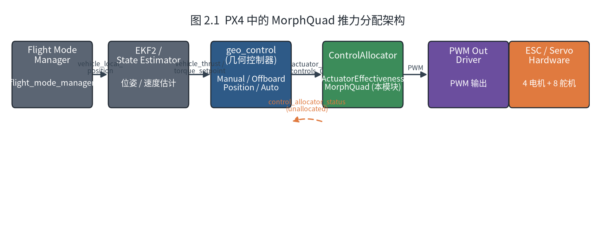
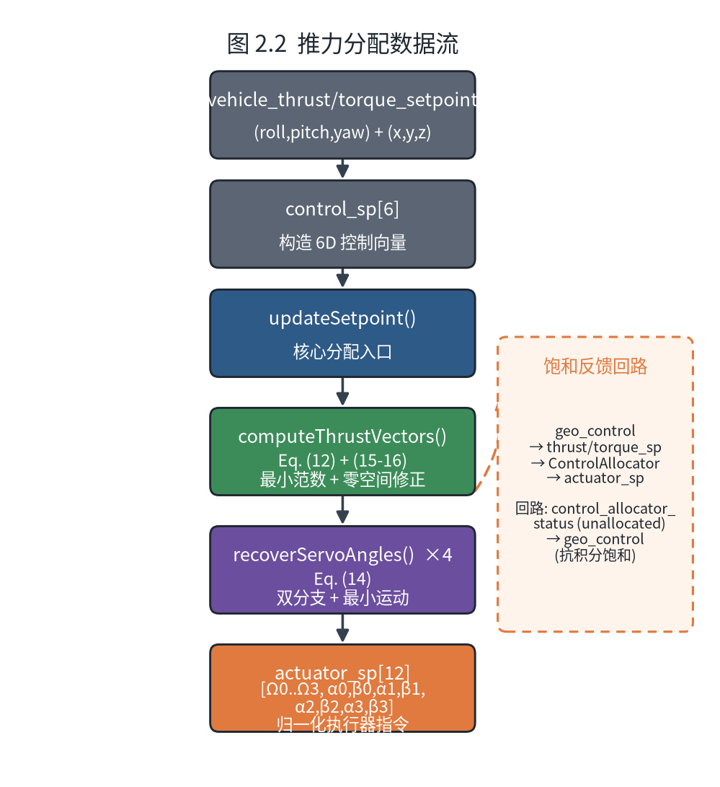
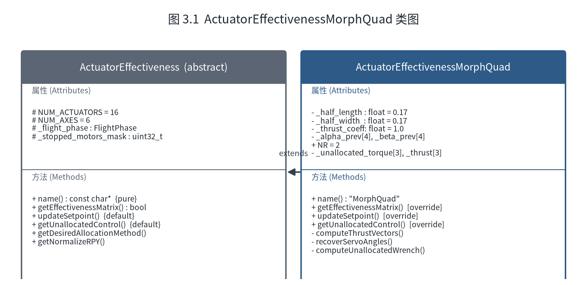
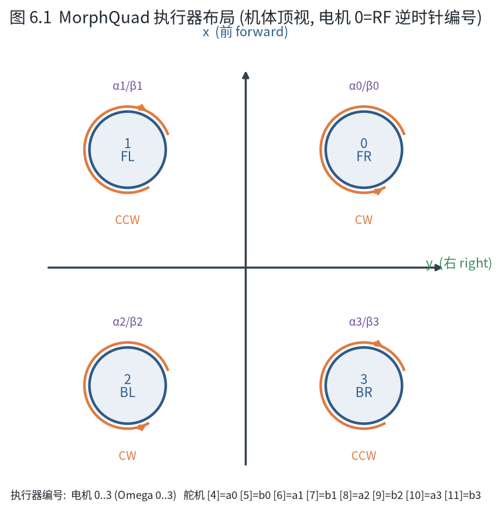

# MorphQuad 推力分配软件设计报告

---

## 1. 文档概述

### 1.1 目的

本文档描述 MorphQuad 可变形四旋翼飞行器推力分配模块的软件设计，包括架构、接口、数据流、关键类设计和集成方式。

### 1.2 范围

- 推力分配核心算法（`ActuatorEffectivenessMorphQuad`）
- PX4 控制分配框架集成
- 几何控制器（`geo_control`）接口
- 参数系统

### 1.3 参考文档

| 文档 | 说明 |
|------|------|
| arXiv:2607.02764v3 | MorphQuad 论文原文 |
| 算法设计报告 | 数学推导与算法伪代码 |
| PX4 Developer Guide | PX4 控制分配框架文档 |

---

## 2. 系统架构

### 2.1 在 PX4 中的位置



### 2.2 数据流



---

## 3. 类设计

### 3.1 类图



### 3.2 关键成员变量

| 变量 | 类型 | 默认值 | 说明 |
|------|------|--------|------|
| `_half_length` | `float` | 0.17f | 机体 x 方向半臂长 [m]，对应论文 $l = \|l_{i,x}\|$ |
| `_half_width` | `float` | 0.17f | 机体 y 方向半臂宽 [m]，对应论文 $b = \|l_{i,y}\|$ |
| `_thrust_coeff` | `float` | 1.0f | 推力系数 $c_t$ [N/(rad/s)²]，$\mathbf{t}_i = c_t \mathbf{G}_i \Omega_i^2$ |
| `_alpha_prev[4]` | `float[]` | {0} | 上一周期外舵机角度 [rad]，用于最小运动选择 |
| `_beta_prev[4]` | `float[]` | {0} | 上一周期内舵机角度 [rad]，用于最小运动选择 |
| `NR` | `static constexpr int` | 2 | 多圈缠绕检查的最大圈数 |
| `_motor_saturated` | `bool` | false | 电机饱和标志，`updateSetpoint()` 中电机输出被 clamp 时置 true |
| `_servo_saturated` | `bool` | false | 舵机饱和标志，`updateSetpoint()` 中舵机输出被 clamp 时置 true |
| `_unallocated_torque[3]` | `float[]` | {0} | 未分配力矩 [roll, pitch, yaw]，由 `computeUnallocatedWrench()` 计算 |
| `_unallocated_thrust[3]` | `float[]` | {0} | 未分配推力 [x, y, z]，由 `computeUnallocatedWrench()` 计算 |

### 3.3 方法说明

#### `getEffectivenessMatrix()`

```cpp
bool getEffectivenessMatrix(Configuration &configuration,
                           EffectivenessUpdateReason external_update) override;
```

**职责**：向 PX4 控制分配框架注册执行器。

**行为**：
- 仅在 `external_update != NO_EXTERNAL_UPDATE` 时执行（几何结构静态）
- 注册 4 个电机（推力方向 `[0, 0, -1]`，NED 下 -z = 向上）
- 注册 8 个舵机（4 外 $\alpha$ + 4 内 $\beta$，实际分配在 `updateSetpoint` 中完成）
- 返回 `true` 表示矩阵已更新

**设计决策**：采用 **Pattern B**（零矩阵 + `updateSetpoint` 覆盖），原因见算法设计报告 §5.1。

#### `updateSetpoint()`

```cpp
void updateSetpoint(const Vector<float, NUM_AXES> &control_sp, int matrix_index,
                   ActuatorVector &actuator_sp,
                   const ActuatorVector &actuator_min,
                   const ActuatorVector &actuator_max) override;
```

**职责**：核心推力分配入口，将 6D wrench 转换为 12 个执行器指令（4 电机 + 8 舵机）。

**输入**：
- `control_sp[6]`：`[roll_torque, pitch_torque, yaw_torque, thrust_x, thrust_y, thrust_z]`
- `actuator_min[16]`、`actuator_max[16]`：执行器限幅

**输出**：
- `actuator_sp[0..3]`：电机 0..3 转速归一化值 [0, 1]
- `actuator_sp[4 + 2i]`：电机 $i$ 外舵机 $\alpha_i$ 归一化角度 [-1, 1]（$i=0..3$）
- `actuator_sp[5 + 2i]`：电机 $i$ 内舵机 $\beta_i$ 归一化角度 [-1, 1]（$i=0..3$）

**处理流程**：
1. 从 `control_sp` 提取 $\mathbf{f}_d$ 和 $\boldsymbol{\tau}_d$
2. 调用 `computeThrustVectors()` 计算 4 个推力向量
3. 对每个旋翼调用 `recoverServoAngles()` 反解舵机角度和电机转速
4. 按 §6.2.3 的交错约定归一化并写入 `actuator_sp[0..11]`
5. 饱和处理（clamp 到 `[min, max]`）

#### `computeThrustVectors()`

```cpp
void computeThrustVectors(const Vector3f &f_des, const Vector3f &tau_des,
                         float t_out[4][3]);
```

**职责**：实现论文 Eq. (12) + (15-16)，将 wrench 分解为 4 个推力向量。

**内部步骤**：
1. 计算几何常数 $r = \sqrt{l^2 + b^2}$
2. 构建偏航单位向量 $\hat{\mathbf{e}}_{\psi,i}$（Eq. 13）
3. 计算最小范数解 $\mathbf{t}_{\min}$（Eq. 12）
4. 若 $\|\mathbf{f}\| > 0.01$，应用零空间修正：
   - 万向节锁避免：添加交替 y 分量修正
   - 下洗干扰避免：当 $|\hat{f}_x| > 0.7$ 时添加 x 分量修正

#### `recoverServoAngles()`

```cpp
void recoverServoAngles(const float t[3], int idx,
                       float &alpha_out, float &beta_out, float &omega_out);
```

**职责**：实现论文 Eq. (14)，从推力向量反解舵机角度和电机转速。

**内部步骤**：
1. 计算 $\Omega_i = \|\mathbf{t}_i\| / c_t$
2. 若 $\|\mathbf{t}_i\| < 0.01$，保持上一周期角度（避免零推力时抖动）
3. 计算单位推力方向 $\hat{\mathbf{t}}_i$
4. 计算两个分支解 $(\alpha_1, \beta_1)$ 和 $(\alpha_2, \beta_2)$
5. 最小运动选择：比较 $|\alpha - \alpha_{\text{prev}}| + |\beta - \beta_{\text{prev}}|$
6. 多圈缠绕检查：$\pm 2k\pi$（$|k| \leq N_R$）
7. 钳位 $\beta \in [-\pi/2, 3\pi/2]$
8. 更新历史角度

#### `getUnallocatedControl()`

```cpp
void getUnallocatedControl() override;
```

**职责**：覆写框架默认实现，将计算得到的未分配力矩/推力写入成员变量，供 `control_allocator_status` uORB 消息发布。

**行为**：
- 调用 `computeUnallocatedWrench()` 重建实际达成的 wrench
- 将期望 wrench 与实际 wrench 之差存入 `_unallocated_torque[3]` 和 `_unallocated_thrust[3]`
- ControlAllocator 框架在每周期结束时读取这些值并发布到 `control_allocator_status` 话题

**设计决策**：当执行器饱和时，期望 wrench 无法完全实现，未分配量反映了控制器"想要但得不到"的部分，geo_control 可据此进行抗积分饱和（anti-windup）。

#### `computeUnallocatedWrench()`

```cpp
void computeUnallocatedWrench(const Vector<float, NUM_AXES> &control_sp,
                              const ActuatorVector &actuator_sp);
```

**职责**：从饱和后的实际执行器输出重建已实现的 wrench（力 + 力矩）。

**内部步骤**：
1. 从 `actuator_sp` 读取实际电机转速 $\Omega_i$ 和舵机角度 $\alpha_i$
2. 根据推力模型 $\mathbf{t}_i = c_t \mathbf{G}_i \Omega_i^2$ 计算各旋翼实际推力
3. 累加各推力对机体原点的力矩 $\boldsymbol{\tau}_{\text{achieved}} = \sum \mathbf{r}_i \times \mathbf{t}_i$
4. 累加推力 $\mathbf{f}_{\text{achieved}} = \sum \mathbf{t}_i$
5. 计算未分配量：$\Delta\boldsymbol{\tau} = \boldsymbol{\tau}_d - \boldsymbol{\tau}_{\text{achieved}}$，$\Delta\mathbf{f} = \mathbf{f}_d - \mathbf{f}_{\text{achieved}}$

---

## 4. 集成设计

### 4.1 ControlAllocator 集成

在 `ControlAllocator.cpp` 的 `update_effectiveness_source()` 中注册：

```cpp
case EffectivenessSource::MORPH_QUAD:  // 枚举值 = 16
    tmp = new ActuatorEffectivenessMorphQuad(this);
    break;
```

在 `ControlAllocator.hpp` 中添加头文件引用和枚举值：

```cpp
#include <ActuatorEffectivenessMorphQuad.hpp>

enum class EffectivenessSource {
    // ...
    MORPH_QUAD = 16,
};
```

### 4.2 CMakeLists.txt 集成

`src/modules/control_allocator/VehicleActuatorEffectiveness/CMakeLists.txt`：

```cmake
px4_add_library(VehicleActuatorEffectiveness
    ActuatorEffectivenessMorphQuad.cpp
    ActuatorEffectivenessMorphQuad.hpp
    # ... 其他文件
)
```

### 4.3 板卡配置

`boards/cuav/7-nano/default.px4board`：

```ini
CONFIG_MODULES_CONTROL_ALLOCATOR=y
CONFIG_MODULES_GEO_CONTROL=y
```

### 4.4 几何控制器接口

`geo_control` 模块输出标准 uORB 消息：
- `vehicle_thrust_setpoint`：机体坐标系期望推力 [N]
- `vehicle_torque_setpoint`：机体坐标系期望力矩 [Nm]

ControlAllocator 订阅这两个话题，构造 6D `control_sp` 向量传入 `updateSetpoint()`。

---

## 5. 参数设计

### 5.1 几何控制器参数（`geo_control` 模块）

| 参数名 | 类型 | 默认值 | 单位 | 说明 |
|--------|------|--------|------|------|
| `GC_MASS` | float | 4.56 | kg | 飞行器质量 |
| `GC_XY_P` | float | 1.0 | - | 位置环比例增益 (XY) |
| `GC_XY_VEL_P` | float | 0.5 | - | 速度环比例增益 (XY) |
| `GC_Z_P` | float | 1.0 | - | 位置环比例增益 (Z) |
| `GC_Z_VEL_P` | float | 0.5 | - | 速度环比例增益 (Z) |
| `GC_RP_P` | float | 6.0 | - | 姿态环比例增益 (Roll/Pitch) |
| `GC_YAW_P` | float | 2.5 | - | 姿态环比例增益 (Yaw) |
| `GC_RP_RATE_P` | float | 0.5 | - | 角速率环比例增益 (Roll/Pitch) |
| `GC_YAW_RATE_P` | float | 0.5 | - | 角速率环比例增益 (Yaw) |
| `GC_INERTIA_XX` | float | 0.1 | kg m² | 惯性矩阵 XX |
| `GC_INERTIA_YY` | float | 0.1 | kg m² | 惯性矩阵 YY |
| `GC_INERTIA_ZZ` | float | 0.2 | kg m² | 惯性矩阵 ZZ |
| `GC_MAN_RATE_MAX` | float | 1.5 | rad/s | Manual 模式最大角速率 |
| `GC_MAN_VEL_MAX` | float | 5.0 | m/s | Manual 模式最大速度 |
| `GC_MAN_DZ` | float | 0.1 | - | Manual 模式摇杆死区 |
| `GC_RATE_I` | float | 0.1 | - | 角速率环积分增益 |
| `GC_RATE_INT_LIM` | float | 0.3 | - | 角速率环积分限幅（抗饱和） |
| `GC_VEL_I` | float | 0.5 | - | 速度环积分增益 |
| `GC_VEL_INT_LIM` | float | 2.0 | - | 速度环积分限幅（抗饱和） |

### 5.2 推力分配硬编码参数

以下参数当前硬编码在 `ActuatorEffectivenessMorphQuad` 中，后续可参数化：

| 参数 | 默认值 | 说明 | 参数化建议 |
|------|--------|------|-----------|
| `_half_length` | 0.17 m | 半臂长 $l$ | `MQ_HALF_LENGTH` |
| `_half_width` | 0.17 m | 半臂宽 $b$ | `MQ_HALF_WIDTH` |
| `_thrust_coeff` | 1.0 N/(rad/s)² | 推力系数 $c_t$ | `MQ_THRUST_COEFF` |
| `gimbal_lock_gain` | 0.3 | 万向节锁修正增益 | `MQ_GIMBAL_GAIN` |
| `downwash_gain` | 0.2 | 下洗修正增益 | `MQ_DOWNWASH_GAIN` |
| `OMEGA_MAX` | 1200 rad/s | 电机最大转速 | `MQ_OMEGA_MAX` |

---

## 6. 执行器映射

### 6.1 执行器布局



### 6.2 执行器编号约定

> 本章节定义 MorphQuad 全部 12 路执行器（4 电机 + 8 舵机）的**唯一编号约定**，作为软件设计与硬件/仿真映射的权威依据。坐标系为机体顶视：$+x$ 指向前方、$+y$ 指向右方。

#### 6.2.1 电机（旋翼）编号

第一个电机为**右前（RF）**，随后按**逆时针**依次编号：

| 电机序号 | 物理位置 | 机体坐标 |
|---------|---------|---------|
| 0 | 右前（RF） | $(+l,\ +b)$ |
| 1 | 左前（LF） | $(+l,\ -b)$ |
| 2 | 左后（LB） | $(-l,\ -b)$ |
| 3 | 右后（RB） | $(-l,\ +b)$ |

逆时针走向：RF → LF → LB → RB（顶视，从右前开始向左转）。

#### 6.2.2 舵机编号

每个电机配备一对舵机：**外舵机 $\alpha$** 与 **内舵机 $\beta$**。舵机按“**先外后内、逐电机**”的顺序编号：

| 舵机序号 | 归属电机 | 类型 | 物理位置 |
|---------|---------|------|---------|
| 0 | 电机 0 (RF) | 外舵机 $\alpha_0$ | 右前外 |
| 1 | 电机 0 (RF) | 内舵机 $\beta_0$ | 右前内 |
| 2 | 电机 1 (LF) | 外舵机 $\alpha_1$ | 左前外 |
| 3 | 电机 1 (LF) | 内舵机 $\beta_1$ | 左前内 |
| 4 | 电机 2 (LB) | 外舵机 $\alpha_2$ | 左后外 |
| 5 | 电机 2 (LB) | 内舵机 $\beta_2$ | 左后内 |
| 6 | 电机 3 (RB) | 外舵机 $\alpha_3$ | 右后外 |
| 7 | 电机 3 (RB) | 内舵机 $\beta_3$ | 右后内 |

通用映射：舵机序号 $k \in [0,7]$，所属电机 $i = \lfloor k/2 \rfloor$，类型由 $k$ 的奇偶决定——偶数为外舵机 $\alpha_i$、奇数为内舵机 $\beta_i$。

#### 6.2.3 归一化与 `actuator_sp` 布局

12 路执行器写入 `actuator_sp[0..11]`，布局如下：

| `actuator_sp` 索引 | 执行器 | 物理量 | 归一化范围 | 归一化公式 |
|-------------------|--------|--------|-----------|-----------|
| 0 | 电机 0 (RF) | $\Omega_0$ | [0, 1] | $\Omega_0 / \Omega_{\max}$，$\Omega_{\max} = 1200$ |
| 1 | 电机 1 (LF) | $\Omega_1$ | [0, 1] | $\Omega_1 / \Omega_{\max}$ |
| 2 | 电机 2 (LB) | $\Omega_2$ | [0, 1] | $\Omega_2 / \Omega_{\max}$ |
| 3 | 电机 3 (RB) | $\Omega_3$ | [0, 1] | $\Omega_3 / \Omega_{\max}$ |
| 4 | 舵机 0（电机0 外 $\alpha_0$） | $\alpha_0$ | [-1, 1] | $\alpha_0 / \pi$ |
| 5 | 舵机 1（电机0 内 $\beta_0$） | $\beta_0$ | [-1, 1] | $\beta_0 / \pi$ |
| 6 | 舵机 2（电机1 外 $\alpha_1$） | $\alpha_1$ | [-1, 1] | $\alpha_1 / \pi$ |
| 7 | 舵机 3（电机1 内 $\beta_1$） | $\beta_1$ | [-1, 1] | $\beta_1 / \pi$ |
| 8 | 舵机 4（电机2 外 $\alpha_2$） | $\alpha_2$ | [-1, 1] | $\alpha_2 / \pi$ |
| 9 | 舵机 5（电机2 内 $\beta_2$） | $\beta_2$ | [-1, 1] | $\beta_2 / \pi$ |
| 10 | 舵机 6（电机3 外 $\alpha_3$） | $\alpha_3$ | [-1, 1] | $\alpha_3 / \pi$ |
| 11 | 舵机 7（电机3 内 $\beta_3$） | $\beta_3$ | [-1, 1] | $\beta_3 / \pi$ |

**桥接层映射**（`configs/morphquad.xml`，`scale=π` 还原弧度）：
- `fcs/esc-cmd-norm[i]` ← `actuator_sp[i]`（电机 $i$，$i=0..3$）
- `fcs/servo-alpha-cmd[i]` ← `actuator_sp[4 + 2i]`（电机 $i$ 的外舵机 $\alpha_i$）
- `fcs/servo-beta-cmd[i]`  ← `actuator_sp[5 + 2i]`（电机 $i$ 的内舵机 $\beta_i$）

旋翼序号与 JSBSim 模型 `morphquad.xml` 中 ROTOR$i$ 的物理位置一一对应。

> **实现状态**：代码 `ActuatorEffectivenessMorphQuad` 已按本约定实现——`updateSetpoint()` 写入
> 电机 `actuator_sp[0..3]` 与外/内舵机 `actuator_sp[4+2i]` / `actuator_sp[5+2i]`，
> `computeUnallocatedWrench()` 按相同索引重建 wrench，旋翼几何为 `RF=(+l,+b)` 逆时针布局。
> 外部桥接层 `configs/morphquad.xml` 需保证 `servo-alpha-cmd[i]→actuator_sp[4+2i]`、
> `servo-beta-cmd[i]→actuator_sp[5+2i]`，且 JSBSim 模型 `morphquad.xml` 中 ROTOR$i$ 的物理位置
> 与本约定的 `RF=(+l,+b)` 一致，否则需相应调整旋向/符号。

---

## 7. 错误处理与边界条件

### 7.1 零推力处理

当 $\|\mathbf{t}_i\| < 0.01$ N 时：
- 保持上一周期的舵机角度（避免除零和抖动）
- 电机转速输出 0

### 7.2 力幅值过小

当 $\|\mathbf{f}_d\| < 0.01$ N 时：
- 跳过零空间修正（修正量与 $\|\mathbf{f}\|$ 成正比，过小无意义）
- 仅使用最小范数解

### 7.3 饱和处理

在 `updateSetpoint()` 末尾按 §6.2.3 的编号约定对 `actuator_sp[0..11]` 执行 clamp，并检测饱和状态：
```cpp
// 饱和检测
_motor_saturated = false;
_servo_saturated = false;

// 4 个电机: actuator_sp[0..3]
for (int i = 0; i < 4; i++) {
    float clamped = math::constrain(actuator_sp(i), actuator_min(i), actuator_max(i));
    if (clamped != actuator_sp(i)) _motor_saturated = true;
    actuator_sp(i) = clamped;
}

// 8 个舵机: 外 α_i 在 4+2i, 内 β_i 在 5+2i
for (int i = 0; i < 4; i++) {
    int alpha_idx = 4 + 2 * i;
    int beta_idx  = 5 + 2 * i;

    float alpha_clamped = math::constrain(actuator_sp(alpha_idx),
                                          actuator_min(alpha_idx), actuator_max(alpha_idx));
    if (alpha_clamped != actuator_sp(alpha_idx)) _servo_saturated = true;
    actuator_sp(alpha_idx) = alpha_clamped;

    float beta_clamped = math::constrain(actuator_sp(beta_idx),
                                         actuator_min(beta_idx), actuator_max(beta_idx));
    if (beta_clamped != actuator_sp(beta_idx)) _servo_saturated = true;
    actuator_sp(beta_idx) = beta_clamped;
}
```

饱和后通过 `getUnallocatedControl()` 计算未分配 wrench：
1. 调用 `computeUnallocatedWrench()` 从饱和后的 `actuator_sp` 重建实际达成的 wrench
2. 未分配量 = 期望 wrench − 实际 wrench
3. 结果写入 `_unallocated_torque[3]` 和 `_unallocated_thrust[3]`
4. ControlAllocator 框架将未分配量通过 `control_allocator_status` uORB 消息发布
5. `geo_control` 订阅该消息，用于积分器抗饱和（anti-windup）：当检测到饱和时，限制积分器继续累积

### 7.4 数值稳定性

- `asin` 输入钳位到 $[-1, 1]$（浮点误差可能导致略微超出）
- $\beta$ 钳位到 $[-\pi/2, 3\pi/2]$（舵机机械限制）
- 所有浮点运算使用 `float`（32 位），与 PX4 嵌入式平台一致

---

## 8. 测试策略

### 8.1 单元测试

| 测试用例 | 输入 | 预期输出 |
|---------|------|---------|
| 悬停 | $\mathbf{f} = [0, 0, -mg]$, $\boldsymbol{\tau} = 0$ | 4 个推力向量均沿 -z，$\Omega_i$ 相等 |
| 纯滚转 | $\mathbf{f} = 0$, $\boldsymbol{\tau} = [\tau_x, 0, 0]$ | 前后旋翼推力差，$\alpha_i$ 对称 |
| 纯偏航 | $\mathbf{f} = 0$, $\boldsymbol{\tau} = [0, 0, \tau_z]$ | 推力在 xy 平面切向分量 |
| 万向节锁 | $\mathbf{f} = [0, f_y, 0]$ | 零空间修正激活，$\beta_i$ 不趋近 $\pm\pi/2$ |
| 下洗干扰 | $\mathbf{f} = [f_x, 0, 0]$, $\boldsymbol{\tau} = 0$ | 零空间修正激活，推力不共线 |

### 8.2 集成测试

- SITL 仿真：使用 Gazebo + MorphQuad 模型验证闭环跟踪性能
- 硬件在环：通过 MAVLink 注入 wrench 指令，验证执行器输出

---

## 9. 版本历史

| 版本 | 日期 | 变更 |
|------|------|------|
| v0.1 | 2026-07-24 | 初始占位符实现（简化分配逻辑） |
| v0.2 | 2026-07-27 | 完整实现论文 Eq. (12)-(16) 算法 |
| v0.3 | 2026-07-27 | 修复编译错误，参数化惯性矩阵，添加 module.yaml |
| v0.4 | 2026-07-29 | 三模式输入 (Manual/Offboard/Auto), 摇杆死区, 积分器+抗饱和, 饱和信号输出 |
| v0.5 | 2026-07-29 | vector 启动脚本 (rc.vector_defaults/rc.vector_apps), CA_AIRFRAME=16 |
| v0.6 | 2026-08-06 | 明确执行器编号约定：电机 0=右前逆时针编号；舵机按"先外后内、逐电机"交错排序（§6.2） |

---

## 10. 待办事项

- [ ] 将硬编码几何参数迁移到 PX4 参数系统
- [x] 扩展执行器数量至 12（4 电机 + 4 外舵机 α + 4 内舵机 β，已通过 actuator_sp[0..11] 输出）
- [ ] 添加单元测试（gtest）
- [ ] SITL 仿真验证
